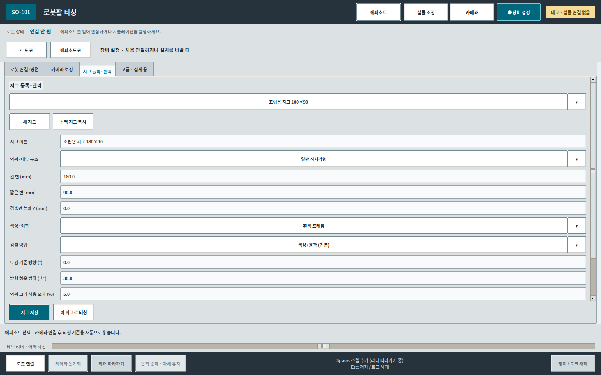
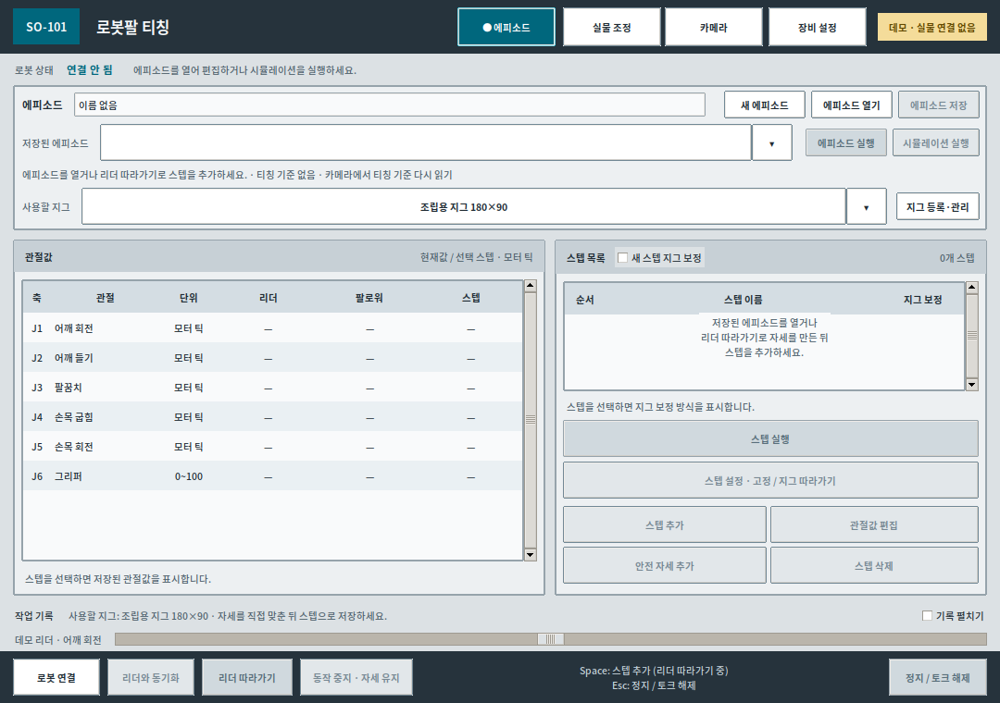

# OpenCV 티칭 GUI

## 현재 자세 유지와 시뮬 영점 (2026-09-23)

실물 손목에서 현재값과 같은 목표에도 이탈하는 현상을 확인했습니다. 시작 시 원시 목표 확인·저속 관찰을 추가하고, 자세 유지 중 이탈은 다음 명령을 보내기 전에 중단하도록 수정했습니다. 근본 원인은 확인 중이며 실물 재검증 상태는 [조사 기록](verification/20260923_hold_incident/REPORT.ko.md)에 남겼습니다.

새로 기록한 영점의 **모델 좌표 변환**과 **추가 보정각**은 별개입니다. 추가 보정각을 0°로 해도 저장한 중간 틱의 기준은 유지됩니다. 집게도 실제 틱 범위를 사용합니다. 베이스의 클램프 제한을 모델의 기계 접촉점으로 해석하지 않습니다.


앱을 실행하면 저장된 상단 카메라 설정으로 자동 연결합니다. 에피소드·시뮬 화면은 유지하며 로봇에는 연결하거나 토크를 켜지 않습니다. 카메라가 없거나 다른 앱에서 사용 중이면 오류를 표시하고 앱은 계속 사용할 수 있습니다. 카메라 화면의 **카메라 연결** 버튼으로 다시 시도하세요.


## STL 형상·검출면과 카메라 방향 가져오기

**지그 등록·관리 → STL 파일 선택 → 외곽·내부 구조 선택 → 지그 저장** 순서입니다. STL 가상 도킹 위치 조정은 제거했습니다. 파일을 등록했을 때는 로봇만 표시하고, 실행 시 지그 위치·각도를 측정하여 확정한 뒤 지그를 시뮬에 표시합니다.

- **직사각형**은 외곽을 검사합니다. **도넛형 (내부 구멍 있음)**은 직사각형 외곽 안에 구멍이 있는 파렛트·프레임용입니다. 원형 외곽을 뜻하지 않습니다. 기존 3×2 선택은 도넛형으로 읽으며, 고정된 칸 수는 요구하지 않습니다.
- 도넛형에 STL을 등록하면 위에서 본 외곽 윗면의 개구부의 위치를 검출에 참고합니다. 여러 구멍이 있는 STL은 큰 구멍 경계 두 곳 이상의 일치를 요구합니다. 부품이나 흰 바탕이 구멍 경계를 가리면 확정하지 못할 수 있습니다. 구멍이 없는 STL은 직사각형을 사용하세요.
- **카메라 각도 가져오기**: 상단 카메라를 연결한 상태에서 누르면 감지 화면으로 넘어가 선택한 지그를 최대 3초 측정합니다. 완료하면 관리 화면으로 돌아와 **도킹 기준 방향**에 로봇 좌표 기준 각도를 적용합니다. 실패·취소하면 기존 값을 유지합니다. 입력된 각도는 **지그 저장**으로 저장합니다. 이 버튼은 에피소드 실행이나 티칭 기준 저장을 하지 않습니다.
- 측정 완료 시 **도킹 기준 방향** 입력칸으로 초점이 이동하고 **입력됨 · 아직 저장 전**을 표시합니다. **지그 저장** 후 같은 지그를 사용하는 기존 에피소드의 검출 방향·허용 범위에도 반영됩니다. 티칭한 자세·상대 위치는 유지합니다.
- 관절 영점 변경 후 새 프로필에서 카메라 보정이 비어 있으면, 같은 로봇·현재 연결된 같은 카메라·해상도·체커보드·동일 CAD 마운트의 기존 보정값만 복원합니다. 후보가 다르거나 기존 보정이 일부라도 있으면 덮어쓰지 않습니다. 측정에 필요한 보정이 없으면 각도를 입력하지 않고 카메라 설정에서 원인을 표시합니다.
- 도킹 기준 방향은 긴 변의 대략적인 방향입니다. 0°는 로봇 앞(+X), 90°는 로봇 왼쪽(+Y)이며 위에서 볼 때 반시계 방향이 +입니다. 직사각형은 180°, 정사각형·가까운 비율은 90° 대칭 중 기존 기준에 가까운 쪽을 선택합니다. 각도 가져오기 동안만 이전 방향 허용 범위를 적용하지 않으며, 실제 실행에서는 저장된 방향 허용 범위를 유지합니다.
- 다운로드의 `모델링/파렛트/파렛트.stl`은 **70×70×25mm**, 외곽 윗면 **20mm**, 중앙 개구부 1개입니다. `도넛형`으로 등록하세요. 테이블 바닥 Z −7.4mm를 가정하면 검출면 Z는 **12.6mm**입니다. 다른 받침 위에 놓으면 해당 설치 높이를 적용해야 합니다.
- **검출면 높이**는 STL 전체 최고점이 아니라 바깥 테두리 윗면으로 계산합니다. 현재 제공 STL은 전체 6mm, 외곽 윗면 4.8mm입니다. 현재 마운트·테이블 기준 바닥 Z −7.4mm를 더하여 검출면 Z는 −2.6mm입니다. 설치 받침 높이가 바뀌면 이 값도 달라집니다.
- STL 단위는 mm/cm/m를 선택합니다. Z가 위인 모델을 사용하며, 바닥 중심과 긴 변 기준으로 정렬한 파일을 앱 폴더에 보관합니다. **STL 외곽 크기 적용**으로 긴 변·짧은 변을 입력합니다.
- 확정된 XY·각도를 시뮬에 반영하고, STL 외곽 윗면을 검출면 Z에 맞춥니다. STL이 없거나 치수가 맞지 않으면 측정 외곽만 표시합니다. 기준을 해제하면 지그 표시도 사라집니다. STL은 새 질량·충돌 모델로 사용하지 않습니다.

## 여러 지그·실행 모드와 손으로 티칭하기

스텝 설정은 기존 오른쪽 3D 미리보기 영역을 대신 사용합니다. 왼쪽 에피소드·스텝 목록은 유지하며, 시뮬 보기 버튼으로 같은 영역을 시뮬로 되돌립니다. 관절값 편집·실물 조정에서는 시뮬을 함께 표시합니다. 상단 장비 모니터링 버튼으로 전압·온도·토크 상태를 바로 엽니다. 실행 중 자동 측정은 카메라 화면에서 확인하고, 확정 즉시 에피소드 화면으로 돌아와 남은 스텝을 이어서 실행합니다. 측정 실패 시 감지 화면에 원인을 표시합니다.

- 에피소드 이름 오른쪽 **이름 변경**으로 표시 이름을 바꿉니다. 저장된 파일은 같은 경로에 갱신하며 스텝·보정값은 유지합니다.
- 한 에피소드에서 **새 스텝의 지그**를 바꿔 가며 저장할 수 있습니다. 기존 스텝은 바뀌지 않습니다. 기존 스텝을 바꾸려면 **스텝 설정 → 따라갈 지그**를 선택합니다. 해당 지그의 티칭 기준이 필요합니다.
- **카메라 → 감지 확인 → 범위를 설정할 지그**를 선택한 뒤 영상에서 범위를 끌어 지정합니다. 범위는 지그별로 저장되고 같은 지그에 연결된 스텝에만 적용됩니다. 비슷한 지그는 서로 겹치지 않는 범위를 지정하세요.
- 티칭 중 읽은 기준은 지그별로 유지합니다. 전체 에피소드 실행 시 안전 자세에서 사용 중인 모든 지그를 새로 측정하고, 스텝 실행 시에는 그 스텝의 지그만 새로 측정합니다. 미검출 지그를 다른 지그의 좌표로 대신하지 않습니다.
- `opencv-teach` 실행 시 **팔로워 단독 / 리더·팔로워 함께**와 로봇 프로필을 선택합니다. 장비 설정에서도 다음 실행 모드를 저장할 수 있습니다. 함께 모드는 두 팔의 포트·각자 보정 JSON으로 새 프로필을 등록하거나 기존 프로필을 선택합니다.
- **팔로워 단독은 연결만으로 토크가 켜지지 않습니다.** 팔을 받쳐 손으로 자세를 맞추고 정지한 뒤 **현재 자세로 스텝 추가** 또는 Space로 저장하세요. 실물 조정·이동 전에는 **현재 자세 유지 · 토크 켜기**를 누릅니다. **손으로 조정 · 토크 끄기**는 연결을 유지하며 토크를 끕니다. 정지/Esc는 연결 종료 절차를 사용합니다.
- OpenCV 미리보기와 Test_teach에 32×32 카메라 마운트를 표시합니다. STL 기준 `base_link`는 받침 바닥보다 7.4mm 위이며, 이전 테이블 직결 기준보다 5mm 높습니다. Test_teach의 지그는 테이블 높이에 유지했습니다. 카메라 광학 중심은 PCB 면 중앙 0mm이고 기존 로봇 기준 좌표 보정은 바꾸지 않았습니다. 마운트 형상은 표시용이며 충돌 모델은 추가하지 않았습니다.


## 여러 지그 등록·선택

**지그 등록·관리 → 새 지그 → 이름·형태·치수·검출 설정 → 지그 저장 → 에피소드의 사용할 지그 선택** 순서입니다. 기존 지그를 복사해 다른 규격으로 등록할 수 있습니다. 부품별 집기 위치는 등록하지 않고 직접 티칭합니다.

- 직사각형: 내부 칸 수를 요구하지 않고 사각 외곽을 검사합니다.
- 도넛형 (내부 구멍 있음): 파렛트의 외곽과 내부 구멍을 검사합니다. 등록 STL이 있으면 구멍 배치를 참고합니다.
- 정사각형도 지원합니다. 정사각형·정사각형에 가까운 지그는 90° 대칭 방향 중 도킹 기준 방향에 가까운 쪽을 사용합니다. 원형 외곽·비정형은 지원하지 않습니다.
- 카메라 감지 범위와 검출 방식은 지그별로 저장합니다. 같은 외곽이 동시에 보이면 범위를 좁혀 구별합니다.
- 새 스텝의 **지그 보정**을 켜면 선택 지그에 연결합니다. 이미 연결된 스텝은 다른 지그 선택으로 바뀌지 않습니다. 다른 지그도 같은 에피소드에서 선택하여 새 스텝을 저장할 수 있습니다.
- 지그 치수 편집은 기존 에피소드의 치수·기준을 자동 변경하지 않습니다. 기존 관절값·티칭 파일·모터 보정은 유지합니다.





## 실행 설정 정리

현재 저장된 TCP, 관절 영점, 카메라–로봇 좌표 변환, 지그 크기·높이를 실행에 바로 사용합니다. **TCP 실측 확인·지그 실측 확인 체크는 제거**했고, 모델값 사용 승인을 별도로 요구하지 않습니다. 기존 실측 여부 기록을 완료로 바꾸지는 않습니다.

집게 끝 탭에는 현재 사용값을 먼저 표시하고, 수치 수정과 가상 지그 미리보기는 접힌 고급 항목에 둡니다. 카메라를 다시 설치할 때의 체커보드 좌표 연결은 선택 기능입니다. 평소에는 에피소드 선택 → 티칭 기준 자동 저장 → 스텝 저장/실행만 사용하면 됩니다.

영상과 카메라 보정값 불일치, 지그 미검출, 잘못된 수치, 도달할 수 없는 목표, 모터 통신·상태 오류는 계속 검사합니다. 설정 변경 후에는 앱을 재실행하세요.


## 현재 티칭·실행 순서

1. **에피소드 선택**: 설정된 카메라를 연결하고 티칭 기준을 자동으로 읽습니다. 이때 팔이 지그를 가리지 않게 둡니다.
2. **티칭**: 지그는 고정되어 있다고 가정합니다. 팔을 움직여도 처음 읽은 티칭 기준은 유지합니다.
3. **스텝 저장**: **새 스텝 지그 보정**을 켜고 저장하면 티칭 기준에 대한 상대 위치·방향을 저장합니다. 끄면 고정 관절값을 저장합니다. 안전 자세는 항상 고정입니다.
4. **실행**: 지그 보정 스텝·전체 에피소드는 실행할 때마다 새 지그 위치를 읽습니다. 전체 에피소드는 시작 안전 자세 도착 후 측정합니다. 실행 기준은 티칭 기준을 덮어쓰지 않습니다.

**빠른 측정:** 최대 3초 수집합니다. 정밀이 포함된 일관된 측정 2개면 즉시 확정하고, 3초 시점에는 정밀 1개 또는 일관된 중간 2개도 사용합니다. 중앙값 반경 3mm·각도폭 5° 밖의 값은 제외합니다. 정밀 3 : 중간 1의 기본 가중치에 검출 신뢰도²를 곱합니다. 연속 3초·정밀 2회·유효 비율 70%는 더 이상 저장 필수 조건이 아닙니다. 미검출·여러 후보·오래된 영상이면 저장하거나 실행하지 않습니다.

카메라에는 영상 중심·각도와 현재 검출 품질을 표시합니다. 티칭·실행 기준은 로봇 좌표의 측정 절차 하나로 확정합니다. **티칭 기준 다시 읽기**는 지그를 옮겼을 때 사용합니다. 보정값·지그 설정이 바뀌거나 다른 에피소드를 열면 기준을 다시 확보합니다.


SO-101 팔로워만 연결해 실물을 보며 위치를 조정하고, 테이블이나 도킹한 운반로봇 위 지그를 기준으로 잡기·놓기 스텝을 저장합니다. 리더암은 필요하지 않습니다.

문서 갱신: 2026-09-22. 실행 폴더는 `/path/to/Final_Arm/OpenCV_teach`, 가상환경은 `/path/to/venv`입니다.

## 바로 시작하기

Ubuntu 앱 목록의 **OpenCV 티칭** 또는 터미널의 `opencv-teach`로 실행합니다. il 환경과 GUI 폴더가 자동 적용되며, 모터·카메라는 연결 버튼을 누른 뒤 연결됩니다. 같은 앱을 다시 열면 중복 실행을 안내합니다.

```bash
opencv-teach                 # 실행 모드 선택 후 실물 GUI
opencv-teach --check-only    # 프로필·파일·포트 상태 검사, USB 열기/모터 쓰기 없음
opencv-teach --setup         # 다른 팔로워 등록 또는 보정 JSON 가져오기
opencv-teach --demo          # 하드웨어 없는 데모, 실물 저장과 구분
```

기존 터미널에서 명령을 찾지 못하면 `source ~/.bashrc`를 한 번 실행합니다. 직접 실행은 `bash /path/to/Final_Arm/OpenCV_teach/run.sh`입니다.

## 한 창에서 작업하기

상단의 **에피소드 / 실물 조정 / 카메라 / 장비 설정**으로 작업 화면을 바꿉니다. 스텝 편집·모터 보정·상태 모니터링도 같은 창 안에서 열리며 **← 뒤로 / 에피소드로**로 돌아옵니다. 하단 연결·정지 버튼과 상단 로봇 상태는 계속 표시합니다.

중복 도구 모음과 이전 마커 목표 전환 버튼을 제거했습니다. 중복 모델 영점 화면은 제거하고 SO-101 모터 캘리브레이션으로 통합했으며, 버튼은 테두리·배경·눌림·비활성 상태를 구분합니다. 설명서는 **장비 설정 → 그림 설명서** 또는 F1입니다.

## 간단한 사용 흐름

**장비 설정(처음 한 번) → 스텝 선택 → 스텝 설정 → 고정 위치 / 지그 따라가기 선택 → 에피소드 저장** 순서입니다. 안전 자세는 고정으로 잠겨 있고, 지그 보정 스텝의 몸체 관절은 자동 계산되어 직접 편집할 수 없습니다. 연결된 단계는 한꺼번에 설정할 수 있습니다. [그림과 상세 순서](사용방법.md#스텝에서-고정--지그-따라가기-선택)

## 실물에서 맞추는 순서

1. 처음에는 **장비 설정 → 지그 등록·선택**에서 크기·높이·검출 범위를 확인합니다. 기존 설정이 맞으면 다시 입력하지 않습니다.
2. **팔로워 연결 → 현재 자세 유지 · 토크 켜기** 후 **카메라 → 실물 조정**에서 관절별 ±로 자세를 맞춥니다. ±는 실제 팔을 움직입니다.
3. 에피소드를 선택하면 티칭 기준을 자동으로 읽습니다. 지그가 고정된 상태에서 **새 스텝 지그 보정**을 선택하고 현재 자세를 저장합니다.
4. 메인 화면에서 스텝 선택 → **스텝 설정 · 고정 / 지그 따라가기** → 위치 기준을 선택합니다.
5. 연결된 대기·하강·상승을 확인하고 **에피소드 저장**을 누릅니다. 잡기·놓기 X·Y·Z를 초기 설정에 다시 입력할 필요는 없습니다. 기존 좌표 직접 편집은 고급 설정입니다.

팔에 지그가 가려져도 저장한 기준을 유지합니다. 다음 도킹·지그 이동 후에는 **지그 기준 다시 읽기**, 작업 종료에는 **작업 끝 · 기준 해제**를 누릅니다. 안전 자세·도킹 완료를 자동 판정하는 기능은 없으며 사용자가 확인합니다.

카메라 좌표 보정 전에도 관절 조정과 **현재 자세만 스텝 저장**은 가능합니다. 이는 실제 관절값을 저장하는 일반 스텝이며, 지그 이동을 따라가는 목표와 다릅니다.

## 부품 A의 제자리 왕복 에피소드

저장 목록의 **A 상단 / 구 / 하단 · 집고 제자리에 놓기**를 선택하세요. 최신 Test_teach의 배치·집기점·3mm 접근 여유를 반영했으며, **시작 안전 자세 → 집기·100mm 상승·제자리 놓기·빈 집게 후퇴 → 종료 안전 자세**의 9단계입니다. 처음 40mm 상승 뒤 관절 한계에 따라 최대 25°까지 기울이고, 하강 시 그 경로를 역순으로 사용합니다. 시뮬 유지 토크는 참고 정보이며 실물 모터에 설정하지 않습니다.

전체 실행은 시작 안전 자세 도착 후 최대 3초 안에 새 실행 기준을 읽고 경로를 계산합니다. 개별 지그 스텝도 매번 새 측정을 사용합니다. 티칭 기준은 이 실행 기준과 별도로 유지합니다.

## 전압·온도 상태 모니터링

**장비 설정 → 로봇 연결·영점 → 모터 상태 · 전압·온도**를 누릅니다. 별도 실행 옵션 없이 사용할 수 있습니다. 연결 전에는 대기 안내가 나오며, 메인 화면에서 팔로워를 연결하면 각 관절의 전압·온도·전류·부하·토크·알람을 갱신합니다. **온도 / 전압 / 전류 / 부하 / 위치 오차** 그래프도 선택할 수 있습니다.

**← 뒤로**는 모니터 화면만 닫습니다. 티칭·재생·자세 유지 중에도 같은 로봇 연결에서 측정하며, **정지 / 토크 해제**로 연결을 종료하면 마지막 측정값과 종료 상태를 표시합니다. 데모에서는 예시 데이터임을 표시합니다. [사용 순서](사용방법.md#status-monitor)

## 순간 온도값 튐에 대한 처리

구동 중에는 관절·읽기 경로별로 **온도 raw 65 이상이 연속 5초** 유지될 때 중단합니다. 65 미만으로 돌아오면 해당 타이머만 초기화합니다. 고온 대기 중에는 메인 상태와 진단창에 **온도 높음 2.0/5초**처럼 표시하며, 발생·복귀·중단 이력을 남깁니다.

시작 전 고온, 잘못된 데이터, 통신·모터 상태 오류는 즉시 차단합니다. 고온 감시 중 새 측정이 1.5초를 넘게 받지 못해도 중단합니다. 모터 내부 온도 한도와 전압 보호 설정은 변경하지 않았습니다. 기존 GUI를 정상 종료한 뒤 다시 실행하면 적용됩니다. [설정·적용 범위](사용방법.md#temperature-policy)

## 현재 보정 상태

2026-09-22에 저장 파일을 확인한 기준입니다. 이후 사용자가 보정하면 GUI의 현재 상태를 따릅니다.

| 항목 | 저장 상태 | 남은 확인 |
|---|---|---|
| 팔로워 관절 보정 | 사용자가 새로 맞춘 `follower_right.json` 적용 | 연결 시 모터 값과 파일 비교 |
| 카메라 렌즈 보정 | 13×9 내부 코너, 간격 20mm, 35장, 1280×720, RMS 약 0.335px | 렌즈·초점·해상도 변경 시 재확인 |
| 카메라와 로봇의 좌표 연결 | CAD 모델 추정 적용, 광학 중심 PCB 면 중앙(0mm) | 실제 기준점으로 위치·영상 축 확인 |
| 집게 끝 기준(TCP) | 왼쪽 고정 집게 끝단 중심, 모델값 적용 | 여러 자세에서 실측 확인 |
| 지그 기준 | 실물 조정은 버튼 저장, 9단계 전체 실행은 시작 안전 자세 도착 후 새 3초 측정 | 정밀·중간 검출의 연속 안정성 확인 |

카메라 중심은 모델 기준 약 (26.0, −116.0, 545.7)mm, 아래쪽 수직에서 약 25°입니다. 렌즈 돌출 20mm는 사용자 확인에 따라 광학 중심 위치에 더하지 않았습니다. GUI는 **모델 추정 · 실측 미확인**으로 표시합니다.

렌즈 보정만으로 실물 mm 좌표가 결정되지는 않습니다. ‘지그 기준 저장’에는 카메라–로봇 좌표 보정이 필요합니다. 실물 목표 실행에는 지그와 집게 끝의 실측 확인도 필요합니다.

## 문서 안내

- [사용방법](사용방법.md): 보정, 도킹 기준, 실물 조정, 두 가지 저장 방법, 실행·문제 해결.
- [그림 사용설명서](guide/사용설명서.html) · [PDF 설명서](guide/OpenCV_티칭_사용설명서.pdf): GUI의 **그림 설명서** 또는 F1에서도 열 수 있습니다.
- [SO-101 시뮬레이션](../Test_teach/README.md): 부품 A 상단·구·하단 배치, 질량·마찰, 집기 후보 시험.
- [링크 질량 계산](calibration/link_mass/README.md) · [고정 집게 TCP](calibration/tcp_geometry/README.md) · [카메라 마운트 CAD 검토](calibration/mount_geometry/README.md).
- [화면 구성과 참고 자료](UI_REFERENCES.md) · [이전 성능 개선 기록](OPTIMIZATION.ko.md).

**카메라 / 실물 조정** 화면에는 감지·조정 기능을, **장비 설정**에는 **로봇 연결·영점 / 카메라 보정 / 지그 등록·선택 / 고급 · 집게 끝**을 모았습니다. 관절값 편집은 저장만 하며 **스텝 실행**으로 이동합니다. 실물 조정의 슬라이더·±는 실제 팔을 움직입니다.

## 데이터와 검증

- `follower.json`: 실물 팔로워 단독 프로필. 보정 원본은 `calibration/opencv_follower_right/follower_right.json`입니다.
- `teaching/`: 에피소드. `teaching/vision/<로봇식별해시>.json`: 카메라·TCP·지그 설정.
- `calibration/camera_images/`: 카메라 보정 사진. 다운로드 폴더에 ZIP·문서를 별도로 만들지 않습니다.
- 활성 지그 기준은 이번 작업 동안만 유지합니다. 목표 파일에 남긴 측정 이력은 앱 재시작·새 도킹 때 활성 기준으로 복원하지 않습니다.
- 3초 안정화·실행 시 측정·모델 좌표 보정을 포함한 최근 회귀 검증은 **237개 통과**입니다. 실물 모터 구동·파지 정밀도 검증 결과는 아닙니다.
- 2026-09-22 실물 확인: 연결 후 자세 유지, 손목 미세 조정, **A 구 에피소드의 시작 안전 자세만** 실행해 도착을 확인했습니다. 집기·지그 측정·전체 에피소드 실행은 수행하지 않았습니다.

```bash
cd /path/to/Final_Arm
bash OpenCV_teach/run_tests.sh
```

Tk GUI 테스트에는 사용 가능한 디스플레이가 필요합니다. 실행기는 이번 테스트에서 새로 생긴 `Final_Arm/MUJOCO_LOG.TXT`와 `OpenCV_teach/MUJOCO_LOG.TXT`만 정리하고 종료 코드를 유지합니다. 기존 로그·티칭·보정·모터 진단 파일은 보존합니다. 자세한 사용 순서는 [사용방법](사용방법.md)을 따릅니다.

현재는 사용자가 확인한 새 모터 영점과 모델 오프셋 0°를 적용했습니다. 기존 안전 자세는 물리적 모터 위치를 유지하도록 환산했고, A 부품 에피소드 6개의 경로도 새 보정으로 계산했습니다. 카메라·TCP 정밀 실측 확인은 별도입니다.

**팔별 영점 맞추기:** 장비 설정 → 로봇 연결·영점 → SO-101 모터 캘리브레이션 · 영점·집게. 리더/팔로워를 선택한 뒤 기존 보정 JSON을 적용하거나 중간 자세와 관절·집게 범위를 새로 측정합니다.

미세 ± 조정은 목표에 도달하지 못해도 2.5초 뒤 현재 자세 유지로 돌아옵니다. 같은 방향의 작은 요청은 제한 안에서 누적하며 요청/실제 변화량을 표시합니다. 공식 SO-101 중간 자세를 영점 화면의 기본 기준으로 사용하고 5관절 일괄 기록을 지원합니다. [조정 대기 문제 수정](사용방법.md#-조정-후-버튼이-잠기고-60초-뒤-연결이-종료될-때).

일상 조작의 반복 확인창을 줄였습니다. 팔로워 연결·단일 스텝은 바로 실행하고 전체 에피소드·리더 동기화만 한 번 확인합니다. 관절 ±는 모터 틱을 사용하며 주요 작업은 같은 창에서 전환합니다. [조작 방식](사용방법.md#간단해진-조작-방식).

**실제 모터 영점·집게 범위 저장:** 장비 설정 → SO-101 모터 캘리브레이션. 리더/팔로워 선택 → 힘 해제 → 중간 자세 영점 → 집게 포함 범위 측정 → EEPROM 읽기 검증과 JSON 저장 순서입니다. 앱 재시작 후 새 보정으로 티칭합니다.

실물 조정·스텝 편집·집게 열림/닫힘 설정에 슬라이더를 제공합니다. 몸체는 모터 틱, 집게는 0~100이며 실물 이동은 드래그를 놓을 때 한 번 요청합니다. [자세한 사용법](사용방법.md#앱-전체의-서보-슬라이더와-모터-틱).

## 2026-09-22 현재 영점 적용

사용자가 확인한 새 모터 영점을 기준으로 부품 A 상단·구·하단의 왕복 에피소드 3개와 기존 시뮬 후보 3개를 갱신했습니다. 모두 시작·종료 안전 자세를 포함한 9단계입니다. 고정 안전 자세는 이전과 같은 물리적 엔코더 위치가 되도록 환산하고 지그 목표 경로는 새 보정 범위에서 다시 계산했습니다. Test_teach도 같은 영점과 모터 틱 표시를 사용합니다.

모델 관절 오프셋은 5개 모두 0°이며 이전 손목 −90° 추정은 더 이상 적용하지 않습니다. 카메라·TCP는 모델 추정 상태로 유지합니다. 실물 집기 성공은 아직 검증하지 않았습니다.

이미 보정 JSON이 있다면 **장비 설정 → SO-101 모터 캘리브레이션 → 기존 보정 JSON 선택**으로 읽습니다. 선택만으로 모터는 바뀌지 않습니다. 내용 확인 후 **선택한 보정 적용**을 눌러 해당 팔의 모터와 활성 JSON에 기록하고 앱을 재실행합니다. 새 보정을 할 때마다 기존 에피소드가 자동 변환되지는 않습니다.

## 마우스로 감지 범위 지정하기

**카메라 → 감지 확인 → 감지 범위 직접 지정**을 누르고 영상에서 마우스로 사각형을 끌어 놓습니다. 지그가 아직 검출되지 않아도 지정할 수 있습니다. 파란 테두리 안에서 선택한 지그를 찾고, 범위는 해당 지그 설정에 저장됩니다. **전체 범위로**를 누르면 제한을 해제합니다. 여러 부품이 같은 지그를 공유하면 같은 범위를 사용합니다.

영상 바깥 여백은 제외하며 반대 방향으로 끌어도 됩니다. 너무 작은 범위는 저장하지 않습니다. 지그가 도착할 위치와 회전했을 때의 외곽이 모두 들어오도록 지정하세요. 범위를 바꾸면 이전 지그 기준을 해제하므로 다시 측정합니다. 이전 ‘현재 지그 주변으로 범위 줄이기’ 버튼은 직접 지정으로 교체했습니다.

스텝 관절값 편집은 **왼쪽 편집 / 오른쪽 시뮬**로 표시합니다. 편집 중인 스텝 이름은 상단에 남으며 수치 변경은 시뮬에 즉시 반영됩니다. 적용 전에는 원본 스텝이 바뀌지 않습니다. 현재 작업 메뉴는 **청록색 배경과 ● 표시**로 구분하며, 스텝 편집 중에는 에피소드 메뉴가 선택됩니다.

## 스텝 목록과 편집

- 스텝을 마우스로 잡아 원하는 행으로 끌어 놓아 순서를 바꿉니다. 행이 청록색으로 표시되며, 목록 위·아래 가장자리에서는 스크롤됩니다. Alt+↑/↓도 사용할 수 있습니다. 시작·종료 안전 자세는 처음과 끝에 유지합니다.
- **스텝 실행**은 조작 버튼 맨 위에 길게, **안전 자세 추가 / 스텝 삭제**는 같은 줄에 둡니다. 순서 올리기·내리기 버튼은 제거했습니다. 이미 안전 자세가 있으면 해당 스텝을 선택하며 값을 덮어쓰지 않습니다.
- 스텝 설정의 **집게만 조절** 선택을 제거했습니다. 이전 파일의 집게 단계는 읽기와 실행을 계속 지원합니다.
- 지그 보정 스텝의 관절값 편집에서는 자동 계산되는 몸체 J1~J5의 입력·슬라이더·±를 비활성화합니다. 집게 J6는 편집할 수 있습니다. 같은 목표의 열림/닫힘 값을 공유하는 단계도 함께 갱신하고 경로는 실행 시 다시 계산합니다.
- 고정 스텝은 6개 관절을 모두 편집합니다. 저장 전 시뮬과 스텝 이름을 함께 확인할 수 있습니다.

**실물 조정**은 실제 팔을 조금씩 움직여 위치를 찾을 때, **관절값 편집**은 시뮬에서 먼저 자세를 확인할 때 사용합니다. 관절값 편집만으로 실제 팔은 움직이지 않습니다.

## 2026-09-22 지그 자동 기준 저장·안전 자세 수정

- **지그 기준 저장**은 한 번 누르면 최대 3초 동안 유효한 지그 위치를 수집해 저장합니다.
- **개별 지그 스텝 실행**은 매번 새 지그 위치를 최대 3초간 읽은 뒤 계산합니다.
- **전체 에피소드 실행**은 시작 안전 자세 도착 후 새 3초 측정을 사용합니다. 안전 자세가 없는 지그 에피소드는 현재 위치에서 새 기준을 얻습니다. 기준 저장과 집기 경로의 실측 보정 검사는 별도이므로, TCP 실측 미확인을 확인 완료로 바꾸지 않습니다.
- 실제 사진에서 지그는 약 221×149mm로 검출됐지만 예상 방향 −90°와 현재 약 −173°가 달라 제외됐습니다. 현재 배치의 방향과 지정 ROI를 기존 A 부품 에피소드 6개에 반영했습니다. 카메라 좌표계나 모터 영점 자체를 바꾼 것은 아닙니다.
- ROI 밖 지그는 계속 제외합니다. 테두리를 찾을 때는 전체 영상의 주변 문맥을 사용해 잘못된 안쪽 테두리를 선택하는 문제를 수정했습니다. ROI 전후의 검출 영역 제한은 유지합니다.
- 분석 지연 한도는 1.2초, 원본 카메라 수신 중단 한도는 0.6초로 분리했습니다. 실행 기준은 위의 빠른 측정 조건을 사용합니다.
- 안전 자세는 **팔 쪽에서 집게 끝을 바라보며 시계방향 90°** 회전하도록 손목 회전 값을 **1.824° → −88.176°**로 바꿨습니다. 시작·종료 안전 자세와 Test_teach에 반영했으며 보정 JSON은 유지했습니다.

실시간 기준 저장 확인: 17:01:27, 모델 좌표 **X 231.283 / Y −100.416mm / −172.890°**, 정밀 3회·중간 5회·이상값 1개 제외. 근거: `verification/20260922_reference_recovery/live-reference.json`. 실제 모터 이동·집기 실행은 하지 않았습니다.

## 2026-09-22 선택·감지 범위 유지

- 감지 범위와 검출 방식은 지그 설정에 즉시 저장하며, 에피소드에 남아 있는 예전 값보다 최신 지그 설정을 우선합니다. 같은 지그를 쓰는 에피소드에 공유되며 다른 지그·다른 로봇의 읽기 전용 미리보기에는 적용하지 않습니다.
- 감지 범위 변경만으로 저장된 에피소드 선택을 해제하지 않습니다. 탭 이동 후에도 에피소드와 선택한 스텝을 유지합니다.
- 카메라가 연결된 전체 에피소드 실행은 현재 화면에서 시작하고, 안전 자세 도착 후 지그 위치를 읽을 때 감지 확인 화면으로 이동합니다.

## 현재 TCP 사용 기준

2026-09-22 사용자 요청으로 현재 모델에서 계산한 왼쪽 고정 집게 끝 중심을 실행용 TCP로 사용합니다. `gripper_frame_link` 기준 XYZ는 **1.7734 / 0.6027 / 6.5497mm**, RPY와 추가 관절 영점 보정은 0입니다. 실측 확인 상태는 미확인으로 유지하며, 화면에는 **저장된 모델값 사용**으로 표시합니다. 별도 사용 승인 체크는 요구하지 않습니다. 등록된 지그 크기·높이를 자동으로 사용합니다. 실행 중인 앱은 재시작해야 새 설정을 읽습니다.

## 지그 확정 후 실행이 멈추는 경우

지그 기준 확정은 측정 완료를 뜻하며, 이어서 각 스텝의 위치와 집게 방향을 계산합니다. 계산에 실패하면 **실행 중단 · 지그 측정은 완료됨**을 먼저 표시하고 실패한 스텝 이름·목표 XYZ·계산 오차를 보여 줍니다. 그 스텝의 집기 위치·방향 또는 지그 배치를 조정해야 합니다. 지그 기준을 반복 저장하는 것으로 해결되지는 않습니다.

## 왼쪽 접촉·높이 우선 시험 경로

부품 A의 고정 집게 접촉점은 **부품 자체 좌표의 왼편(−X)**입니다. 지그를 따라가는 스텝은 유지하며 실행/시뮬레이션 시작 때 새로 측정한 지그 위치·각도로 접촉점과 집게 방향을 함께 계산합니다. 고정 위치 스텝으로 변환하지 않습니다. ‘손목 준비’ 중간 단계는 사용하지 않습니다.

상단에서도 집기 위치와 방향을 목표로 삼습니다. 동시에 도달하기 어렵다면 **높이를 우선(계산 오차 0.5mm 이내)** 확보하고 X·Y를 최대 40mm 범위에서 조정합니다. 내려갈수록 X·Y 편차를 줄이고 왼쪽 접촉점으로 맞춥니다. 상승/제자리 복귀 경로는 같은 계산 결과를 역순으로 사용합니다. 상단 손목을 안전 자세 값으로 고정하는 정책은 적용하지 않습니다.

현재 부품 A 에피소드 6개에는 사용자가 요청한 시험 설정을 적용했습니다. 집기 IK는 위치 4mm·방향 6°까지 허용하고, 실제 도착은 기존 일반 티칭 허용 오차(베이스 2°, 어깨 4°, 팔꿈치 3°, 손목 2°)를 사용합니다. 모터 범위·통신·온도·정지 처리는 유지합니다. 이는 실물 집기 성공이나 접촉 정밀도 보증이 아닙니다.

**시뮬레이션 실행**도 새 지그 측정 후 경로를 계산하며 측정된 지그 테두리 또는 등록 STL을 표시합니다. 화면의 ‘현재 지그 측정 보정 적용’을 확인하세요. 카메라가 없으면 현재 지그 보정 재생을 시작하지 않습니다. 경로 계산은 별도 프로세스에서 수행해 GUI/모터 heartbeat와 분리합니다.

확정된 실행 기준은 경로 계산 뒤 재검출을 강제하지 않습니다. 영상 갱신 중단·보정 변경·새 유효 관측에서 지그 이동이 확인된 경우에는 실행을 중단합니다. 경로 계산만으로 토크가 풀리던 현상은 GUI 응답 감시를 해제하지 않고 계산 프로세스를 분리해 처리했습니다.
