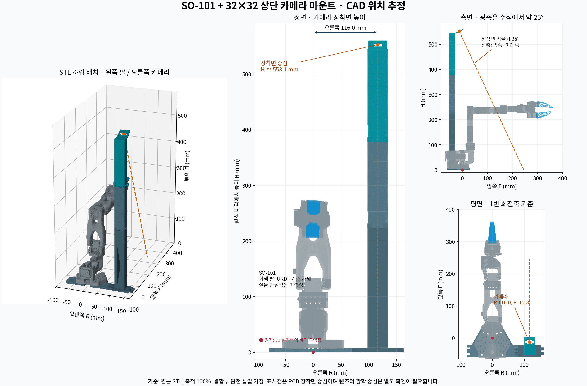

# 왼쪽 SO-101 / 오른쪽 32×32 카메라 마운트: STL 배치 검토

2026-09-21. 사용자가 제공한 설치 사진 및 TheRobotStudio의 원본 STL 네 개를 현재 GUI의 SO-101 URDF와 대조했습니다. **아래 값은 원본 축척 100%와 결합부 완전 삽입을 가정한 CAD 추정값입니다. 실물 광학 보정값은 아닙니다.**



## 한눈에 보는 결과

기준점은 **SO-101 1번 관절(어깨 회전, shoulder_pan) 축을 받침 바닥에 수직으로 내린 점**입니다. 사진 1처럼 로봇이 왼쪽, 카메라 기둥이 오른쪽인 배치입니다.

| 확인 항목 | CAD 추정값 |
|---|---:|
| 카메라 PCB 장착면 중심의 좌우 위치 | 회전축에서 오른쪽 **116.0 mm** |
| 카메라 PCB 장착면 중심의 앞뒤 위치 | 회전축에서 뒤쪽 **12.8 mm** |
| 카메라 PCB 장착면 중심의 높이 | 받침 바닥에서 **553.1 mm** |
| 마운트 전체 최고점 | 받침 바닥에서 **560.4 mm** |
| 카메라 광축의 기울기 | 수직 아래 방향에서 작업대 앞쪽으로 약 **25°** |
| 카메라 시선의 수평선 기준 하향각 | 약 **65°** |
| 로봇 1번 관절 원점 높이 | 받침 바닥에서 **69.8 mm** |
| 로봇 본체 바닥의 받침 높이 | **5.0 mm** |

장착면 기울기는 실제 STL의 면을 적합해 계산했습니다. 광축 방향은 렌즈가 PCB에 수직이고 장착면과 평행하게 PCB를 고정한다는 가정입니다. 표시된 소수 자릿수는 설계 좌표를 설명하기 위한 것이며 조립품의 실측 정확도를 뜻하지 않습니다.

## GUI 모델의 로봇 기준 좌표

현재 `assets/so101/so101_modified.urdf`의 `base_link`를 기준으로 하면 **+X는 작업대 앞쪽, +Y는 왼쪽, +Z는 위쪽**입니다. `base_link`는 1번 회전축이나 바닥 중심과 같은 점이 아닙니다.

| 대상 | X (mm) | Y (mm) | Z (mm) |
|---|---:|---:|---:|
| base_link | 0 | 0 | 0 |
| 1번 관절 원점 (URDF 값) | 38.8353 | 약 0 | 62.4 |
| 카메라 PCB 장착면 중심 | **26.0** | **−116.0** | **545.7** |

`base_link` 자체는 받침 바닥보다 7.4 mm 높고, 1번 회전축보다 38.8353 mm 뒤쪽입니다. 따라서 카메라 위치를 위 표에서 읽을 때와 회전축 기준으로 읽을 때 앞뒤 값과 높이가 달라집니다.

카메라의 설계상 시선 단위벡터는 로봇 축 기준으로 대략 **(0.4226, 0, −0.9063)** 입니다. 이미지의 오른쪽·아래쪽 축, 즉 광축 주위 회전은 카메라 모듈의 센서 방향과 영상 설정을 확인해야 정할 수 있습니다.

## 계산 근거

원본 STL은 Y축이 높이 방향이고, 서로 다른 파일이 완전히 동일한 원점을 쓰지는 않습니다. `cam_mount_bottom.stl`의 좌표에 맞춘 이동량은 다음과 같습니다. 단위는 mm입니다.

| 원본 부품 | STL X 이동 | STL Y 이동 | STL Z 이동 |
|---|---:|---:|---:|
| cam_mount_bottom | 0 | 0 | 0 |
| arm_base (왼쪽 팔) | 93.92092 | 5.0 | −26.08911 |
| cam_mount_middle | 18.7 | 188.1 | 36.512 |
| cam_mount_top | 18.7 | 188.1 | 36.512 |

- 기둥 하부의 어깨면 Y=223.1과 중간 부품 하단 Y=35를 맞추면 Y 이동량이 188.1입니다. 삽입 돌기는 소켓 내부로 들어가므로 부품 전체 길이를 단순히 합산하지 않았습니다.
- 중간 부품의 상단 어깨면 Y≈190과 상부 부품 하단 Y=190은 원본 좌표에서 이미 맞습니다.
- 왼쪽 받침의 옆 결합 홈·연결 구멍을 카메라 하부 받침과 맞췄습니다. 받침 바닥 −5를 0으로 이동하면 로봇을 받치는 안쪽 평면은 높이 5입니다.
- SO-101 본체와 받침의 체결 기준 4개를 대조했습니다. 현재 URDF 메시의 구멍 중심과 받침의 대응 중심을 이동 정렬한 잔차는 약 0.01 mm입니다. 이는 CAD 파일 간 형상이 일치한다는 근거이지 실물 조립 오차가 0.01 mm라는 뜻은 아닙니다.
- 카메라 상부 STL의 PCB 장착면과 네 개 체결 구멍을 적합했습니다. 평면의 추정 기울기는 24.9994°이며 체결 구멍 사이 간격은 대략 27 mm입니다.
- 현재 URDF의 `shoulder_pan` 원점과 로봇 바닥 높이를 사용해 `base_link`와 회전축 기준 좌표를 구분했습니다.

## STL만으로 확정할 수 없는 것

1. **렌즈의 광학/투영 중심**: 장착면에서 얼마나 떨어져 있는지는 렌즈·센서 모듈의 도면 또는 실측이 필요합니다. 사진 속 렌즈 끝을 광학 중심으로 간주하지 않았습니다.
2. **실제 조립 오차**: 출력 축척, 유격, 나사 체결, 기둥 휨, 추가 스페이서 등에 따라 실제 위치가 달라집니다.
3. **현재 관절 자세**: 실물 팔의 관절값을 읽지 않았습니다. 그림의 팔은 URDF의 0 관절각 기준 자세이며 설치 사진의 팔 자세를 재현한 것이 아닙니다.
4. **카메라 영상 축 방향**: PCB 체결 방향, 센서 방향, 영상 회전·반전 설정을 실제 영상으로 확인해야 합니다.

렌즈가 보드 중앙에 수직으로 배치되어 있고 광학 중심이 장착면 중심에서 시선 방향으로 d mm 떨어져 있다고 가정하면, `base_link` 기준 광학 중심은 대략 `(26.0 + 0.4226d, −116.0, 545.7 − 0.9063d)` mm입니다. d는 이 STL 자료에서 알 수 없으므로 실행용 카메라 변환 행렬을 만들지 않았습니다.

숫자는 별도의 `nominal_pose.json`에 저장했습니다. `verified_for_robot_motion`은 false이며 `camera_optical_transform`은 null입니다. 체커보드로 확인한 실제 보정 결과와 비교할 설계 기준으로 사용합니다. 이 카메라 위치는 GUI의 **체커보드 0번 코너 X·Y·Z** 입력값이 아닙니다.

## 재현

GUI 폴더에서 il 환경으로 실행합니다. USB·모터·카메라를 열지 않으며 MuJoCo를 사용하지 않습니다.

```bash
python calibration/mount_geometry/analyze_mount.py
python calibration/mount_geometry/render_layout.py
```

STL과 현재 URDF 메시를 직접 읽고 계산·그림을 다시 생성합니다. 원본 해시는 `source/provenance.json`에 있습니다.

## 원본 출처

- [공식 마운트 설치 안내](https://github.com/TheRobotStudio/SO-ARM100/blob/eecbe3e0a9ebb23e25ad7b2759b03884c6660903/Optional/Overhead_Cam_Mount_32x32_UVC_Module/README.md)
- [원본 STL 네 개](https://github.com/TheRobotStudio/SO-ARM100/tree/eecbe3e0a9ebb23e25ad7b2759b03884c6660903/Optional/Overhead_Cam_Mount_32x32_UVC_Module/stl)
- 소스 커밋: `eecbe3e0a9ebb23e25ad7b2759b03884c6660903`
- 원본 라이선스: Apache-2.0 (`source/LICENSE`)


## 2026-09-22 GUI 좌표 변환 적용

사용자가 광학 중심을 **PCB 면 중앙(깊이 오프셋 0mm)**으로 지정했습니다. 렌즈의 20mm 돌출 길이는 광학 중심 위치에 더하지 않았습니다. 기존 `nominal_pose.json`은 당시 CAD 분석 기록으로 유지하며, 현재 적용 변환은 `teaching/vision/0f8518c95dc468e0.json`의 `extrinsics`에 저장합니다.

`model_camera.py`에서 변환을 재생성합니다. 광학 중심의 로봇 좌표는 (25.987375, −116.047787, 545.671879)mm입니다. 화면 오른쪽 축은 로봇 −Y, 아래쪽 축은 로봇 쪽을 향하는 설치로 추정했습니다. `source=cad_estimate`, `verified_for_robot_motion=false`를 기록해 실측과 구분합니다. GUI의 카메라 보정에서 광학 중심 거리·영상 축 회전을 확인할 수 있습니다.
