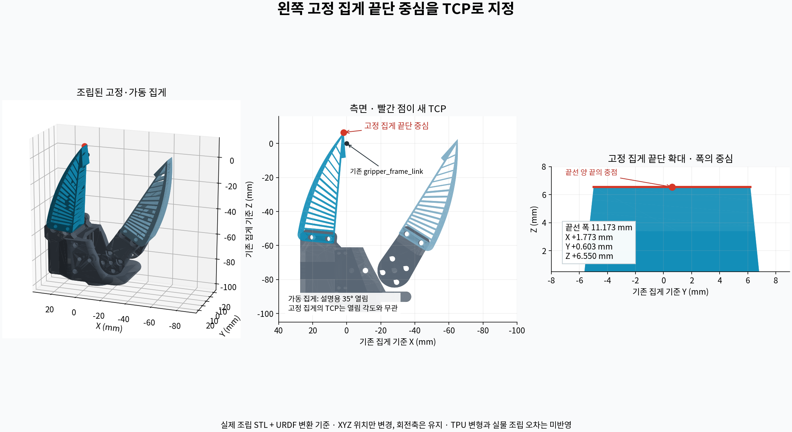

# 왼쪽 고정 집게 끝단 중심 TCP

현재 티칭 모델의 `gripper_link / xlerobot_fixed_finger`를 사용했습니다. 이 STL은 Demo·Sim_real 조립 모델의 고정 손가락 STL과 SHA-256이 같습니다.

- 기준: `gripper_frame_link`의 +Z 방향으로 가장 멀리 뻗은 끝선 양 끝의 중점
- 끝선 폭: 약 11.173 mm
- TCP 위치 오프셋: **X +1.773410, Y +0.602657, Z +6.549654 mm**
- 회전 오프셋: 기존 **0°, 0°, 0°** 유지
- 이 TCP 추출 시에는 모델 관절 추가 보정과 실물 팔로워 관절 JSON을 변경하지 않음
- 고정 손가락의 기준점이므로 가동 손가락 열림 각도에 영향을 받지 않음

기존 `gripper_frame_link` 자체나 로봇 메시를 이동한 것이 아니라, 그 프레임에서 새 TCP까지의 위치 오프셋을 설정했습니다. 가운데 파지 공간의 중심이 아니라 사용자가 지정한 고정 집게 끝단 중심입니다.

`fixed_finger_tip.json`에 원본 URDF·STL 해시, 끝선 꼭짓점 좌표, 계산 정의를 기록했습니다. `render_tip.py`는 실제 조립 메시를 읽어 같은 결과와 확인 그림을 다시 생성합니다.

```bash
/path/to/venv/bin/python /path/to/Final_Arm/OpenCV_teach/calibration/tcp_geometry/render_tip.py
```



현재 팔로워 프로필에 적용했으며, GUI의 **집게 끝 위치 → 모델 끝점 불러오기 → 보정값 저장**으로 재적용할 수 있습니다. 불러오기는 XYZ만 채우며 회전·관절 입력값은 유지합니다. 기존 좌표 경로는 변경한 TCP 기준으로 다시 계산해야 합니다.

이 값은 조립 모델의 기하학적 기준입니다. 실제 TPU 변형·출력 공차·조립 오차를 측정한 값은 아니므로 `verified=false`를 유지합니다. MuJoCo 조립 모델과 기구학 계산을 여러 팔 자세·그리퍼 열림 상태에서 비교했습니다.

## 실물 티칭에서의 사용

**실물로 맞추기 → 맞춘 위치를 목표에 반영**은 실제 관절값과 이 TCP를 사용해 위치·방향을 계산합니다. `지그를 따라가기` 목표는 팔을 물렸을 때 버튼으로 저장한 지그 기준에 대한 상대 위치를 기록합니다. 이후 지그가 가려져도 같은 기준을 사용할 수 있습니다.

TCP·관절 영점 보정값을 바꾸면 기존 도킹 기준은 해제되므로 기준을 다시 읽고 경로를 계산해야 합니다. 자세를 눈으로 맞춰 저장하는 동작 자체가 TCP 실측 확인을 완료시키지는 않습니다. [실물 조정 순서](../../사용방법.md#manual-adjustment)를 참고하세요.

2026-09-22 현재 팔의 손목 회전에는 사진 대조 기준 모델 영점 −90°를 추가했습니다. 위 TCP의 프레임 내 XYZ는 동일하고, 관절 영점은 전체 팔의 순기구학에 적용됩니다. 모터 보정 JSON은 유지하며 정밀 검증 전입니다. [실물과 모델 영점 대조](../../사용방법.md#현재-팔의-손목-회전과-모델-영점)를 참고하세요.
