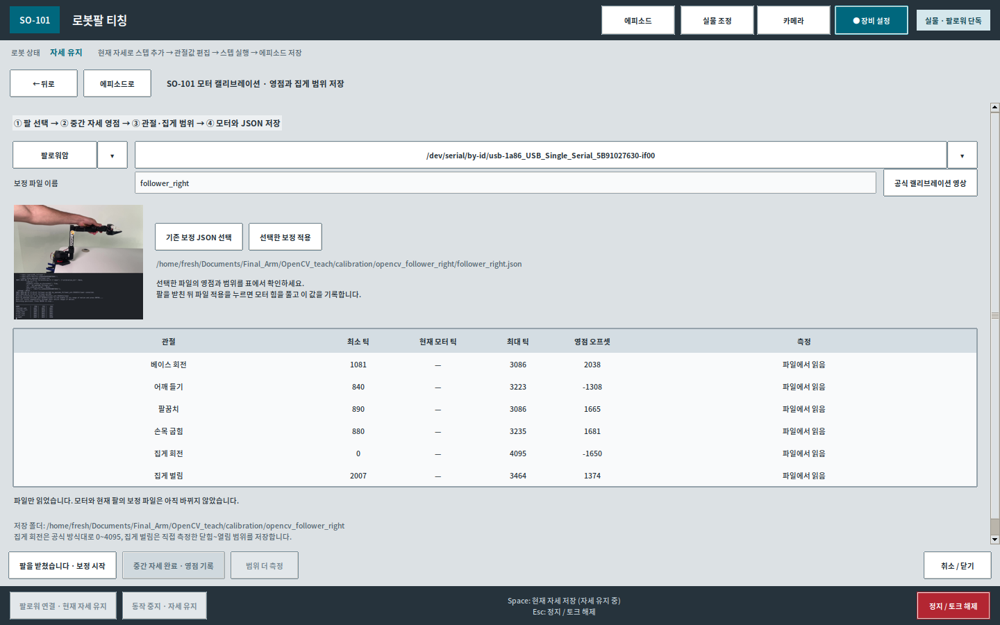
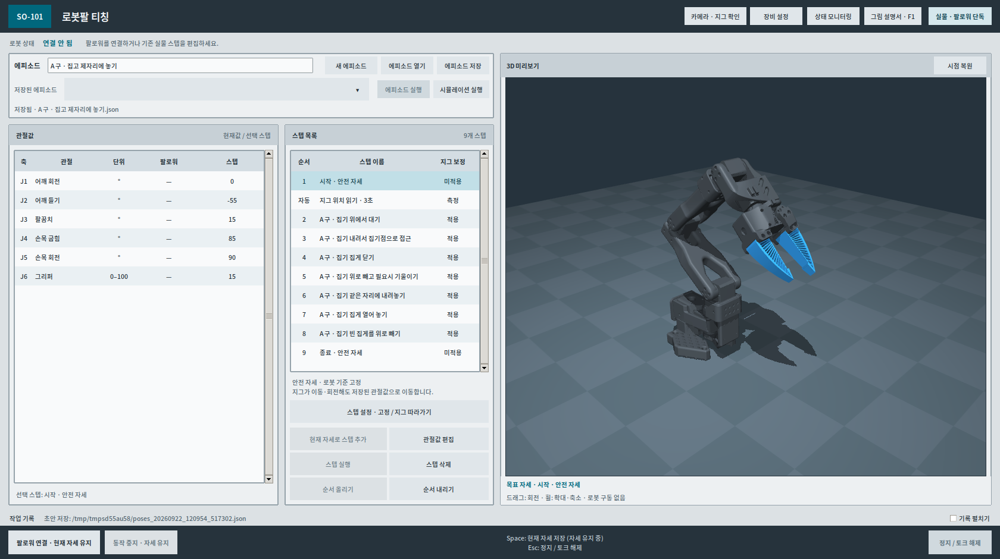
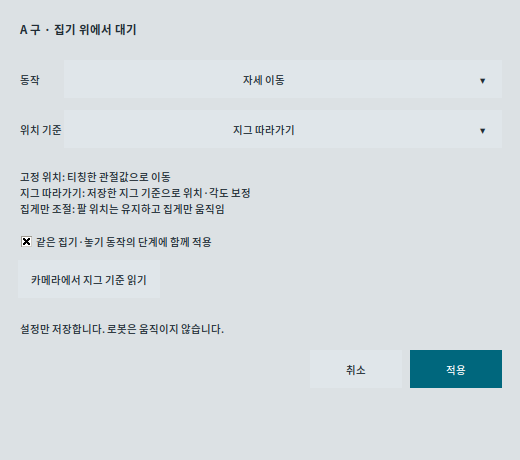
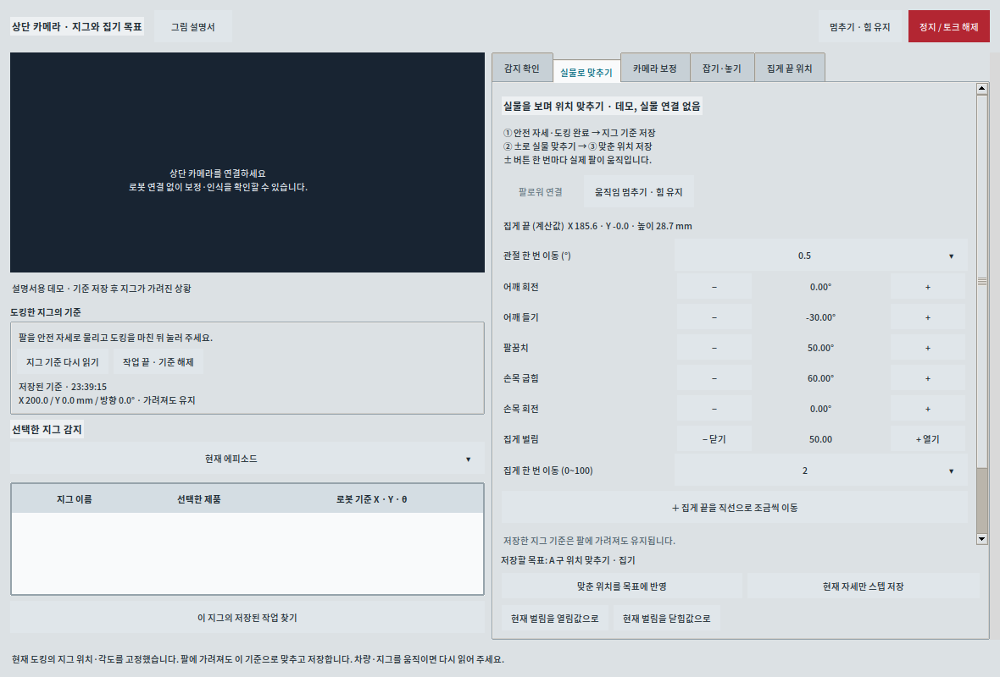
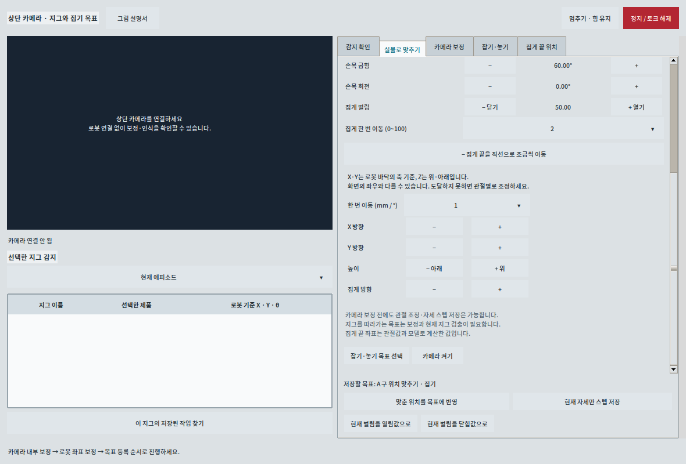
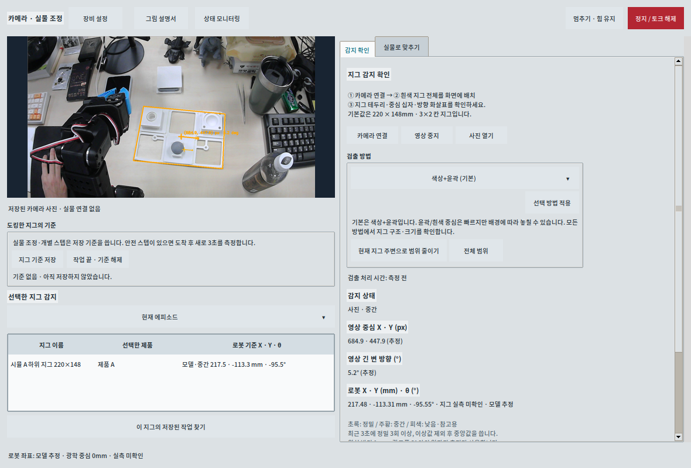
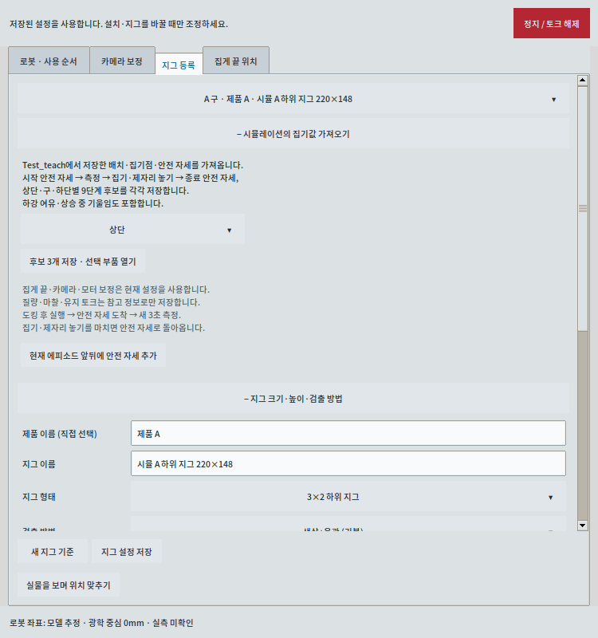
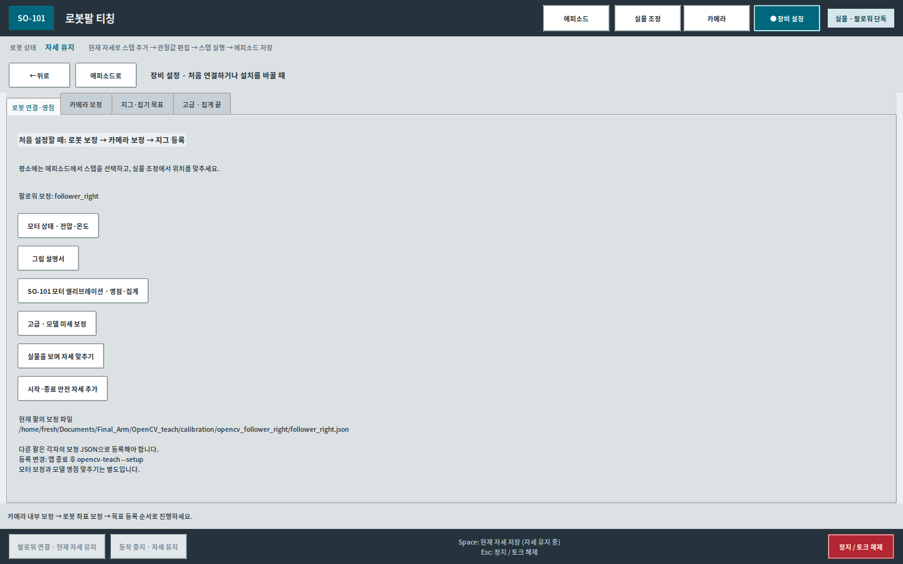
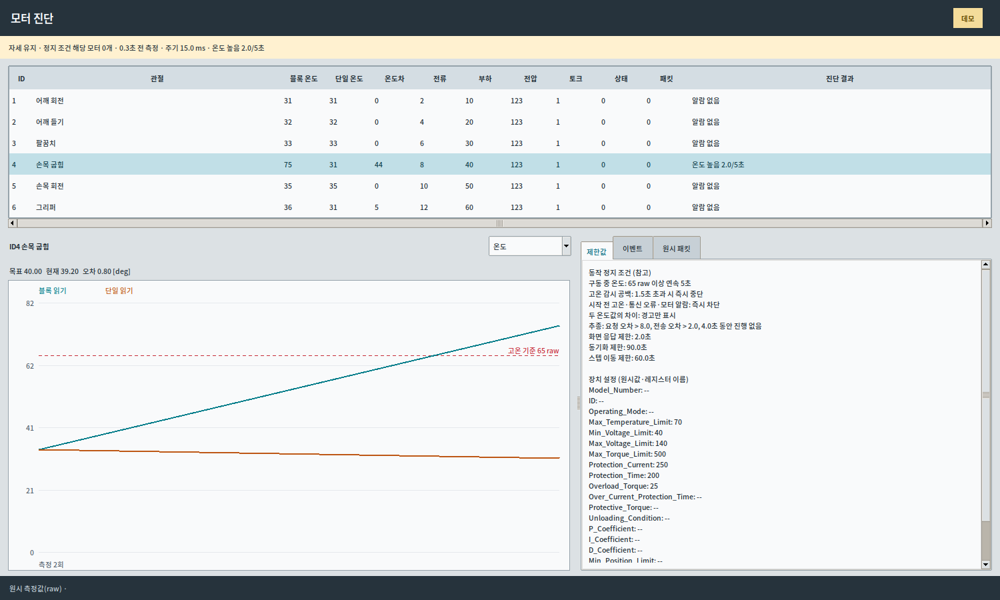

# OpenCV 티칭 사용방법

앱을 실행하면 저장된 상단 카메라 설정으로 자동 연결합니다. 에피소드·시뮬 화면은 유지하며 로봇에는 연결하거나 토크를 켜지 않습니다. 카메라가 없거나 다른 앱에서 사용 중이면 오류를 표시하고 앱은 계속 사용할 수 있습니다. 카메라 화면의 **카메라 연결** 버튼으로 다시 시도하세요.


## 영점과 모터 위치값

영점을 정하기 전 기준 자세의 모터값이 1600대여도 그 숫자만으로 재조립할 필요는 없습니다. 기준 자세에서 영점 설정을 수행하면 `Homing_Offset`을 기록하여 현재 위치를 한 바퀴의 중간값(약 2048)으로 맞춥니다. 이 설정은 위치를 읽는 기준을 바꾸며 팔을 해당 숫자까지 움직이는 명령이 아닙니다. 설정 직후 같은 자세의 값이 중간값 부근인지 확인한 뒤 관절 가동 범위를 기록하고 저장하세요.

모터 중간값과 시뮬의 일자 자세는 별도 기준입니다. 새 영점 파일만으로 시뮬의 일자 자세나 기존 에피소드의 일치가 보장되지는 않습니다. 가장 최근 직접 맞추고 저장한 파일을 기준으로 사용하고, 파일 수정 시각만 보고 과거 값을 복원하지 마세요. 집게 닫힘 기준은 두 끝이 처음 닿는 실제 위치이며, 부하 증가만으로 접촉했다고 확정하지 않습니다.

## 모터 영점과 시뮬 기준의 연결

기준은 **실제 서보 하우징과 링크의 조립 방향이 직각인 자세**입니다. 관절 중심점을 잇는 선으로 맞추지 않습니다. 조인트 중심은 링크 장축에서 벗어나 있기 때문에 그 선을 수직으로 만들면 어깨 링크가 약 14° 기울어집니다. 손목 회전도 앞 링크에 직각이며, 가동 집게가 위로 벌어지는 방향을 사용합니다.

그리퍼는 기록한 중간 틱을 모델의 90°에 연결하고, 이후 각도 변화는 실제 틱 차이 × 360/4095로 계산합니다. 따라서 저장된 벌림 0~100을 그대로 모델 0~100°로 간주하지 않습니다. 모터로 보내는 벌림값과 기존 JSON 형식은 그대로 유지합니다. 모델이 보여주는 닫힘 형상과 실물 접촉 여부는 별도로 확인해야 합니다.

공식 사진의 중간 자세를 모델 기준으로 사용합니다. 상완은 위로, 전완·고정 집게는 앞으로 향하고 가동 집게가 위로 벌어지는 방향입니다. 몸체 관절은 `모델 각도 = LeRobot 관절각 + 모델 보정각`으로 변환합니다. 보정각은 기록한 중간 틱과 모델 기준 자세로 계산하므로 최소·최대 범위가 비대칭이어도 같은 중간 틱이 같은 모델 자세에 대응합니다. 이 보정은 모터 EEPROM을 다시 쓰지 않습니다.

미리보기와 역기구학은 같은 보정각을 사용합니다. 카메라 화면을 열지 않아도 현재 로봇의 보정 파일을 읽고, 고정 스텝 에피소드에도 모델 표시 기준을 함께 저장합니다. 기존 에피소드의 모터 명령값은 자동으로 바꾸지 않습니다. 새로 만든 **위로 일자 자세 · 새 영점**은 팔과 고정 집게의 길이 방향을 위로 맞췄으며, 집게는 닫힘 0% 대신 기록한 중간 벌림을 유지합니다. 계산 기준 변경 후에는 앱을 다시 시작해 에피소드를 다시 여세요.

## STL 형상·검출면과 카메라 방향 가져오기

**지그 등록·관리 → STL 파일 선택 → 외곽·내부 구조 선택 → 지그 저장** 순서입니다. STL 가상 도킹 위치 조정은 제거했습니다. 파일을 등록했을 때는 로봇만 표시하고, 실행 시 지그 위치·각도를 측정하여 확정한 뒤 지그를 시뮬에 표시합니다.

- **직사각형**은 외곽을 검사합니다. **도넛형 (내부 구멍 있음)**은 직사각형 외곽 안에 구멍이 있는 파렛트·프레임용입니다. 원형 외곽을 뜻하지 않습니다. 기존 3×2 선택은 도넛형으로 읽으며, 고정된 칸 수는 요구하지 않습니다.
- 도넛형에 STL을 등록하면 위에서 본 외곽 윗면의 개구부의 위치를 검출에 참고합니다. 여러 구멍이 있는 STL은 큰 구멍 경계 두 곳 이상의 일치를 요구합니다. 부품이나 흰 바탕이 구멍 경계를 가리면 확정하지 못할 수 있습니다. 구멍이 없는 STL은 직사각형을 사용하세요.
- **카메라 각도 가져오기**: 상단 카메라를 연결한 상태에서 누르면 감지 화면으로 넘어가 선택한 지그를 최대 3초 측정합니다. 완료하면 관리 화면으로 돌아와 **도킹 기준 방향**에 로봇 좌표 기준 각도를 적용합니다. 실패·취소하면 기존 값을 유지합니다. 입력된 각도는 **지그 저장**으로 저장합니다. 이 버튼은 에피소드 실행이나 티칭 기준 저장을 하지 않습니다.
- 측정 완료 시 **도킹 기준 방향** 입력칸으로 초점이 이동하고 **입력됨 · 아직 저장 전**을 표시합니다. **지그 저장** 후 같은 지그를 사용하는 기존 에피소드의 검출 방향·허용 범위에도 반영됩니다. 티칭한 자세·상대 위치는 유지합니다.
- 관절 영점 변경 후 새 프로필에서 카메라 보정이 비어 있으면, 같은 로봇·현재 연결된 같은 카메라·해상도·체커보드·동일 CAD 마운트의 기존 보정값만 복원합니다. 후보가 다르거나 기존 보정이 일부라도 있으면 덮어쓰지 않습니다. 측정에 필요한 보정이 없으면 각도를 입력하지 않고 카메라 설정에서 원인을 표시합니다.
- 도킹 기준 방향은 긴 변의 대략적인 방향입니다. 0°는 로봇 앞(+X), 90°는 로봇 왼쪽(+Y)이며 위에서 볼 때 반시계 방향이 +입니다. 직사각형은 180°, 정사각형·가까운 비율은 90° 대칭 중 기존 기준에 가까운 쪽을 선택합니다. 각도 가져오기 동안만 이전 방향 허용 범위를 적용하지 않으며, 실제 실행에서는 저장된 방향 허용 범위를 유지합니다.
- 다운로드의 `모델링/파렛트/파렛트.stl`은 **70×70×25mm**, 외곽 윗면 **20mm**, 중앙 개구부 1개입니다. `도넛형`으로 등록하세요. 테이블 바닥 Z −7.4mm를 가정하면 검출면 Z는 **12.6mm**입니다. 다른 받침 위에 놓으면 해당 설치 높이를 적용해야 합니다.
- **검출면 높이**는 STL 전체 최고점이 아니라 바깥 테두리 윗면으로 계산합니다. 현재 제공 STL은 전체 6mm, 외곽 윗면 4.8mm입니다. 현재 마운트·테이블 기준 바닥 Z −7.4mm를 더하여 검출면 Z는 −2.6mm입니다. 설치 받침 높이가 바뀌면 이 값도 달라집니다.
- STL 단위는 mm/cm/m를 선택합니다. Z가 위인 모델을 사용하며, 바닥 중심과 긴 변 기준으로 정렬한 파일을 앱 폴더에 보관합니다. **STL 외곽 크기 적용**으로 긴 변·짧은 변을 입력합니다.
- 확정된 XY·각도를 시뮬에 반영하고, STL 외곽 윗면을 검출면 Z에 맞춥니다. STL이 없거나 치수가 맞지 않으면 측정 외곽만 표시합니다. 기준을 해제하면 지그 표시도 사라집니다. STL은 새 질량·충돌 모델로 사용하지 않습니다.

## 여러 지그·실행 모드와 손으로 티칭하기

작은 창에서는 스텝 목록의 행을 확보하도록 반복 설명을 접고 버튼 여백을 줄입니다. 자세한 보정 설정은 **스텝 설정**에서 확인하세요.

스텝 설정은 기존 오른쪽 3D 미리보기 영역을 대신 사용합니다. 왼쪽 에피소드·스텝 목록은 유지하며, 시뮬 보기 버튼으로 같은 영역을 시뮬로 되돌립니다. 관절값 편집·실물 조정에서는 시뮬을 함께 표시합니다. 상단 장비 모니터링 버튼으로 전압·온도·토크 상태를 바로 엽니다. 실행 중 자동 측정은 카메라 화면에서 확인하고, 확정 즉시 에피소드 화면으로 돌아와 남은 스텝을 이어서 실행합니다. 측정 실패 시 감지 화면에 원인을 표시합니다.

- 에피소드 이름 오른쪽 **이름 변경**으로 표시 이름을 바꿉니다. 저장된 파일은 같은 경로에 갱신하며 스텝·보정값은 유지합니다.
- 한 에피소드에서 **새 스텝의 지그**를 바꿔 가며 저장할 수 있습니다. 기존 스텝은 바뀌지 않습니다. 기존 스텝을 바꾸려면 **스텝 설정 → 따라갈 지그**를 선택합니다. 해당 지그의 티칭 기준이 필요합니다.
- **카메라 → 감지 확인 → 범위를 설정할 지그**를 선택한 뒤 영상에서 범위를 끌어 지정합니다. 범위는 지그별로 저장되고 같은 지그에 연결된 스텝에만 적용됩니다. 비슷한 지그는 서로 겹치지 않는 범위를 지정하세요.
- 티칭 중 읽은 기준은 지그별로 유지합니다. 전체 에피소드 실행 시 안전 자세에서 사용 중인 모든 지그를 새로 측정하고, 스텝 실행 시에는 그 스텝의 지그만 새로 측정합니다. 미검출 지그를 다른 지그의 좌표로 대신하지 않습니다.
- `opencv-teach` 실행 시 **팔로워 단독 / 리더·팔로워 함께**와 로봇 프로필을 선택합니다. 장비 설정에서도 다음 실행 모드를 저장할 수 있습니다. 함께 모드는 두 팔의 포트·각자 보정 JSON으로 새 프로필을 등록하거나 기존 프로필을 선택합니다.
- **팔로워 단독은 연결만으로 토크가 켜지지 않습니다.** 팔을 받쳐 손으로 자세를 맞추고 정지한 뒤 **현재 자세로 스텝 추가** 또는 Space로 저장하세요. 실물 조정·이동 전에는 **현재 자세 유지 · 토크 켜기**를 누릅니다. **손으로 조정 · 토크 끄기**는 연결을 유지하며 토크를 끕니다. 정지/Esc는 연결 종료 절차를 사용합니다.
- OpenCV 미리보기와 Test_teach에 32×32 카메라 마운트를 표시합니다. STL 기준 `base_link`는 받침 바닥보다 7.4mm 위이며, 이전 테이블 직결 기준보다 5mm 높습니다. Test_teach의 지그는 테이블 높이에 유지했습니다. 카메라 광학 중심은 PCB 면 중앙 0mm이고 기존 로봇 기준 좌표 보정은 바꾸지 않았습니다. 마운트 형상은 표시용이며 충돌 모델은 추가하지 않았습니다.


## 여러 지그 등록·선택

**지그 등록·관리 → 새 지그 → 이름·형태·치수·검출 설정 → 지그 저장 → 에피소드의 사용할 지그 선택** 순서입니다. 기존 지그를 복사해 다른 규격으로 등록할 수 있습니다. 부품별 집기 위치는 등록하지 않고 직접 티칭합니다.

- 직사각형: 내부 칸 수를 요구하지 않고 사각 외곽을 검사합니다.
- 도넛형 (내부 구멍 있음): 파렛트의 외곽과 내부 구멍을 검사합니다. 등록 STL이 있으면 구멍 배치를 참고합니다.
- 정사각형도 지원합니다. 정사각형·정사각형에 가까운 지그는 90° 대칭 방향 중 도킹 기준 방향에 가까운 쪽을 사용합니다. 원형 외곽·비정형은 지원하지 않습니다.
- 카메라 감지 범위와 검출 방식은 지그별로 저장합니다. 같은 외곽이 동시에 보이면 범위를 좁혀 구별합니다.
- 새 스텝의 **지그 보정**을 켜면 선택 지그에 연결합니다. 이미 연결된 스텝은 다른 지그 선택으로 바뀌지 않습니다. 다른 지그도 같은 에피소드에서 선택하여 새 스텝을 저장할 수 있습니다.
- 지그 치수 편집은 기존 에피소드의 치수·기준을 자동 변경하지 않습니다. 기존 관절값·티칭 파일·모터 보정은 유지합니다.


## 실행 설정 정리

현재 저장된 TCP, 관절 영점, 카메라–로봇 좌표 변환, 지그 크기·높이를 실행에 바로 사용합니다. **TCP 실측 확인·지그 실측 확인 체크는 제거**했고, 모델값 사용 승인을 별도로 요구하지 않습니다. 기존 실측 여부 기록을 완료로 바꾸지는 않습니다.

집게 끝 탭에는 현재 사용값을 먼저 표시하고, 수치 수정과 가상 지그 미리보기는 접힌 고급 항목에 둡니다. 카메라를 다시 설치할 때의 체커보드 좌표 연결은 선택 기능입니다. 평소에는 에피소드 선택 → 티칭 기준 자동 저장 → 스텝 저장/실행만 사용하면 됩니다.

영상과 카메라 보정값 불일치, 지그 미검출, 잘못된 수치, 도달할 수 없는 목표, 모터 통신·상태 오류는 계속 검사합니다. 설정 변경 후에는 앱을 재실행하세요.


## 현재 티칭·실행 순서

1. **에피소드 선택**: 설정된 카메라를 연결하고 티칭 기준을 자동으로 읽습니다. 이때 팔이 지그를 가리지 않게 둡니다.
2. **티칭**: 지그는 고정되어 있다고 가정합니다. 팔을 움직여도 처음 읽은 티칭 기준은 유지합니다.
3. **스텝 저장**: **새 스텝 지그 보정**을 켜고 저장하면 티칭 기준에 대한 상대 위치·방향을 저장합니다. 끄면 고정 관절값을 저장합니다. 안전 자세는 항상 고정입니다.
4. **실행**: 지그 보정 스텝·전체 에피소드는 실행할 때마다 새 지그 위치를 읽습니다. 전체 에피소드는 시작 안전 자세 도착 후 측정합니다. 실행 기준은 티칭 기준을 덮어쓰지 않습니다.

**빠른 측정:** 최대 3초 수집합니다. 정밀이 포함된 일관된 측정 2개면 즉시 확정하고, 3초 시점에는 정밀 1개 또는 일관된 중간 2개도 사용합니다. 중앙값 반경 3mm·각도폭 5° 밖의 값은 제외합니다. 정밀 3 : 중간 1의 기본 가중치에 검출 신뢰도²를 곱합니다. 연속 3초·정밀 2회·유효 비율 70%는 더 이상 저장 필수 조건이 아닙니다. 미검출·여러 후보·오래된 영상이면 저장하거나 실행하지 않습니다.

카메라에는 영상 중심·각도와 현재 검출 품질을 표시합니다. 티칭·실행 기준은 로봇 좌표의 측정 절차 하나로 확정합니다. **티칭 기준 다시 읽기**는 지그를 옮겼을 때 사용합니다. 보정값·지그 설정이 바뀌거나 다른 에피소드를 열면 기준을 다시 확보합니다.


문서 갱신: 2026-09-22. 현재 팔로워 단독·도킹 기준 저장 흐름을 기준으로 설명합니다.

실행 폴더: `/path/to/Final_Arm/OpenCV_teach`  
가상환경: `/path/to/venv` (Python 3.10)

## 바로 시작하기

Ubuntu 앱 목록의 **OpenCV 티칭**을 누르면 터미널 없이 il 환경에서 실물 팔로워 단독 GUI가 열립니다.
같은 앱을 다시 누르면 중복 실행을 안내합니다. GUI 폴더에 있는 `run.sh`와 `opencv-teach`도 사용할 수 있습니다.

- [그림 사용설명서 (HTML)](guide/사용설명서.html) · [PDF 설명서](guide/OpenCV_티칭_사용설명서.pdf)
- **장비 설정 → 그림 설명서** 또는 F1 키로 설명서를 엽니다.
- 상단 **에피소드 / 실물 조정 / 카메라 / 장비 설정**으로 같은 창의 작업 화면을 바꿉니다. **← 뒤로 / 에피소드로**로 돌아오며 로봇 상태·연결·정지는 항상 보입니다.
- 메인 화면의 **관절값 편집**은 몸체 모터 틱과 집게 0~100 슬라이더로 값을 바꾸며 적용만으로 움직이지 않습니다. **실물 조정**의 ±는 실제 팔을 움직입니다.
- 보정 사진은 `calibration/camera_images`에 모아 두었습니다. 새 사진도 이 폴더에 추가합니다.
- 앱 메뉴 재등록: il 환경에서 `python install_app.py`. 실행 오류 기록: `~/.local/state/opencv-teach/app.log`.

## SO-101 실제 모터 캘리브레이션

**장비 설정 → 로봇 연결·영점 → SO-101 모터 캘리브레이션 · 영점·집게**를 엽니다.

1. 팔로워암 또는 리더암을 선택하고 해당 USB 포트와 보정 파일 이름을 확인합니다. 선택한 팔만 연결하므로 리더 단독 보정도 가능합니다.
2. 팔을 받치고 **팔을 받쳤습니다 · 보정 시작**을 누릅니다. 기존 티칭 연결을 닫고 모터 힘을 풉니다.
3. **그리퍼를 포함한 6개 서보**를 화면의 공식 사진처럼 상완은 위로, 전완·집게는 앞으로 향하게 맞추고 **전체 서보 중간 자세 기록**을 누릅니다. 고정 집게는 아래에 두고 가동 집게가 위로 벌어지게 맞춥니다. `set_half_turn_homings()`로 현재 자세의 모터 좌표를 약 2048틱(설치된 라이브러리 기준 **2047**)으로 맞추고 실제 읽기값을 확인합니다. 모터가 그 숫자까지 회전하는 명령이 아닙니다.
4. **6개 서보 모두**를 하나씩 중간 자세의 양쪽 사용 범위 끝까지 손으로 움직입니다. 손목 회전도 직접 측정하며 더 이상 0~4095를 자동 입력하지 않습니다. 표에 **최소 / 기록한 중간 / 현재 / 최대 틱**이 표시됩니다. 집게는 두 끝이 처음 닿는 닫힘 위치와 사용할 최대 열림까지 측정합니다. 기록한 중간 틱은 범위를 더 측정해도 바뀌지 않습니다. 사용 범위가 0/4095 경계를 넘으면 중간 자세를 다시 잡으세요.
5. **범위 측정 완료 → 모터와 JSON에 저장**을 누릅니다. 모터의 `Homing_Offset`, `Min_Position_Limit`, `Max_Position_Limit`를 쓰고 다시 읽어 일치하는지 확인한 뒤 선택한 팔의 JSON을 저장합니다.
6. 앱을 다시 실행합니다. 새 보정은 관절값의 의미를 바꾸므로 이전 에피소드 자세를 다시 확인·기록합니다. 카메라와 TCP 형상 설정은 새 로봇 식별값으로 이어받되 팔로워 모델 영점은 기록한 중간 틱과 공식 사진에 대응하는 모델 자세로 계산합니다. 실제 자세 일치는 별도 확인이 필요합니다.

이 보정은 손으로 움직여 측정합니다. 원래 공식 절차와 달리 손목 회전도 직접 사용 범위를 기록합니다. 보정 화면에서 모터를 구동하는 슬라이더를 사용하지 않습니다. 취소·저장 오류 시 기존 EEPROM 보정 복원을 시도하고 기존 JSON을 보존합니다. 복원에 실패하면 오류와 복원 자료 경로를 표시합니다. 시작 전 값, 중간 자세의 보정 전후 틱, 저장할 보정값은 `teaching/motor-diagnostics/calibration_recovery_*.json`에 보존합니다. 최종 보정 JSON은 LeRobot 호환 형식을 유지합니다. 표의 기록한 중간 틱은 측정 범위의 산술 평균과 다를 수 있으며, 기존 관절 각도·집게 0~100 변환 방식은 유지합니다. 집게의 모터 중간 자세와 닫힘 0%는 서로 다른 기준입니다.

이 기능 구현 과정에서 실제 팔의 영점·범위는 새로 측정하거나 덮어쓰지 않았습니다. 사용자가 자세와 범위를 맞춘 후 버튼을 눌러 실제 보정을 진행합니다.

출처: [LeRobot SO-101 공식 절차](https://huggingface.co/docs/lerobot/v0.4.4/en/so101#calibrate), [공식 보정 영상](https://huggingface.co/datasets/huggingface/documentation-images/resolve/main/lerobot/calibrate_so101_2.mp4). 화면의 기준 사진은 이 영상 10초 지점입니다. 시뮬 모델 자세 미세 보정은 별도 기능입니다.

## 기존 모터 보정 파일 선택

1. **장비 설정 → 로봇 연결·영점 → SO-101 모터 캘리브레이션 · 영점·집게**로 이동합니다.
2. 팔로워 또는 리더와 USB 포트를 확인하고 **기존 보정 JSON 선택**을 누릅니다. 현재 창 안의 목록에서 파일을 고릅니다.
3. 표의 관절별 영점·최소·최대 틱을 확인합니다. 이 단계는 읽기만 하며 모터나 활성 보정 파일을 바꾸지 않습니다.
4. **선택한 보정 적용**을 누르면 선택한 팔의 힘을 풀고 파일 값을 모터에 기록합니다. 새 중간 자세나 범위를 측정하지 않습니다. 읽기 검증 후 현재 팔의 활성 JSON을 저장합니다.
5. 앱을 재실행합니다. 잘못된 관절·ID·범위의 파일은 연결 전에 거부합니다. 실패·취소 시 기존 보정 복원을 시도합니다.



## 확인한 새 영점으로 에피소드·시뮬 적용

현재 기준은 `calibration/opencv_follower_right/follower_right.json`이며, 로봇 설정은 `teaching/vision/d2a355c6404a6476.json`입니다. 사용자 확인에 따라 모델 관절 오프셋은 모두 0°로 두었습니다.

- **A 상단·구·하단 · 집고 제자리에 놓기**, **시뮬 후보 · A 상단·구·하단** 총 6개를 같은 기준으로 변환했습니다. 각 9단계이며 시작·종료 안전 자세는 고정 위치입니다.
- 기존 안전 자세의 모터 위치를 유지하도록 영점·범위를 환산했습니다. 새 관절값은 순서대로 약 **2.989 / −54.516 / 14.560 / 84.956 / −88.176°**, 집게 **14.468**입니다. 화면의 정수 모터 틱은 이 값의 반올림 표시입니다.
- 지그 상대 집기점·100mm 상승·제자리 놓기 목표는 유지하고 새 관절 범위로 경로를 다시 계산했습니다. 집게 닫힘 0은 새 측정 범위의 닫힘 끝점입니다.
- Test_teach의 준비·안전 자세와 관절 슬라이더도 새 보정에 맞췄습니다. 시뮬 접촉 시험의 상승량은 상단 100.285mm, 구 100.995mm, 하단 97.379mm였습니다. 실물 실행 결과는 아닙니다.
- 이후 다른 보정 파일을 적용한다고 모든 에피소드가 자동 변환되는 것은 아닙니다. 기존 초안·진단 기록은 보존했습니다. 변환 근거는 `verification/20260922_zero_rebase/migration.json`입니다.

## 앱 전체의 서보 슬라이더와 모터 틱

- **실물 조정 / 시뮬 모델 자세 미세 보정:** 몸체는 모터 틱으로 조정합니다. 슬라이더를 드래그할 때 목표값만 표시하고 놓으면 현재 측정값에서 해당 변화량을 한 번 요청합니다. 몸체는 ±50틱, 집게는 ±5 벌림 범위입니다. ± 버튼은 작은 요청을 누적할 수 있습니다.
- **집게 끝 X·Y·높이·방향 조정:** 각각 ±2mm 또는 ±2°의 슬라이더를 사용하며, 0.5 단위로 놓을 때 이동을 요청합니다.
- **스텝 관절값 편집:** 6개 관절 모두 숫자 입력과 슬라이더를 함께 제공합니다. 몸체는 보정 범위 안의 정수 틱, 집게는 0~100입니다. 수정값 적용은 저장만 하며 스텝 실행 버튼으로 이동합니다.
- **집기·놓기 목표의 집게 열림·닫힘값:** 0~100 슬라이더와 숫자 입력을 함께 사용합니다. 목표 저장 전에는 실제 모터를 움직이지 않습니다.
- 메인 관절표는 모터 틱을 표시하고 실물 조정창은 **현재 틱과 환산 각도**를 같이 표시합니다. 이동 중에도 값과 모델을 계속 갱신합니다.
- 1틱은 약 0.088°입니다. 작은 목표를 움직이지 않은 채 도착으로 판단하지 않도록 검사하며, 정수 틱 변환에서 1틱이 잘리는 반올림 오차도 수정했습니다. 기어 유격·마찰 때문에 1틱 명령이 실제 1틱 이동을 보장하지는 않습니다.
- 저장된 티칭 파일과 운동학 계산은 기존 각도 형식을 유지합니다. 수정하지 않은 관절값은 원래 정밀도로 보존합니다. TCP·지그 방향 등 공간 좌표 설정의 mm·° 단위도 유지합니다.

## 간단해진 조작 방식

- **팔로워 연결**과 **관절값 읽기 연결**은 추가 확인창 없이 시작합니다.
- **스텝 실행**은 선택한 한 단계만 바로 실행합니다. 지그를 따라가는 스텝도 기준·경로 검사가 통과하면 별도 확인창 없이 실행합니다.
- **전체 에피소드 실행**과 **리더 자세로 동기화**에는 짧은 확인 한 번만 표시합니다. 긴 경고문과 허용 오차 설명은 반복하지 않습니다.
- 실물 관절 조정은 **1·5·10·20·50 모터 틱**를 선택할 수 있습니다. 50틱 조정은 현재 측정값에서 새로 시작하며 이전 미세 요청을 더하지 않습니다. 다른 관절의 유지 목표는 유지합니다.
- 작업 화면은 상단 메뉴로 이동합니다. 모터 보정 도중 이동하면 기존 보정 복원·연결 종료를 마친 뒤 화면을 나옵니다. 실제 동작 중에는 기록·저장 등 상태가 맞지 않는 조작만 대기합니다.

관절 범위·최신 측정값·모터 오류·과열·통신 중단 검사는 그대로 적용합니다. 모터 JSON과 모터 내부 보호값은 바꾸지 않았습니다.

## 스텝에서 고정 / 지그 따라가기 선택

일반 티칭에서는 **잡기·놓기 좌표를 숫자로 다시 입력하지 않습니다.** 장비 설정의 지그 등록에는 크기·높이·검출 범위만 설정하고, 실제 작업 위치는 스텝으로 저장합니다. 아래 문서의 기존 목표 좌표·4/7단계 생성 설명은 **고급 기능을 사용할 때만** 참고하세요.


1. **장비 설정**에서 로봇 보정 파일, 카메라, 지그 등록, 집게 끝을 확인합니다. 저장된 설정은 다시 입력하지 않습니다.
2. 메인 목록에서 스텝을 선택하고 **스텝 설정 · 고정 / 지그 따라가기**를 누릅니다.
3. **고정 위치**는 티칭한 관절값, **지그 따라가기**는 저장된 지그 기준으로 계산한 위치·각도를 사용합니다.
4. 연결된 상단 대기·하강·상승을 함께 바꾸려면 **같은 집기·놓기 동작의 단계에 함께 적용**을 선택합니다. 단계 하나만 바꾸면 연결 경로가 맞지 않아 실행이 거부될 수 있습니다.
5. **적용 → 에피소드 저장**으로 마칩니다. 적용 자체로 로봇이 움직이지 않습니다. 안전 자세는 항상 고정입니다.

처음 일반 관절 스텝에 ‘지그 따라가기’를 켤 때는 등록된 지그를 선택하고 **지그 기준 저장**을 먼저 누릅니다. 해당 스텝의 집게 끝을 지그 좌표로 변환해 보관합니다. 안전 스텝이 없다면 모델 후보 안전 자세를 앞뒤에 추가하므로, 관절값 편집에서 실제 안전 위치로 맞추세요. 고정 위치로 되돌리면 원래 티칭 관절값을 복원합니다. 고정 관절값을 새로 편집했다면 다음 보정 설정 때 기준을 다시 읽습니다.

| 로봇팔의 공정 예 | 안전 자세 | 잡기 | 놓기 |
|---|---|---|---|
| A / C | 고정 | 고정 | 지그 따라가기 |
| B | 고정 | 지그 따라가기 | 고정 |

위 표는 공정별 선택 예시입니다. 프로그램이 이름만 보고 자동 전환하지 않습니다. **‘부품 A 상단·구·하단’ 테스트 에피소드의 A는 부품 종류**이며 로봇팔 역할 A와 다릅니다. 이 테스트는 같은 지그에서 집고 제자리에 놓으므로 왕복 단계를 모두 지그 기준으로 유지했습니다.




보정을 사용하는 에피소드에는 안전 자세 다음에 **자동 · 지그 위치 읽기 · 3초** 행이 표시됩니다. 이 행은 측정 순서를 보여주며 관절 이동 스텝은 아닙니다. 모두 고정으로 바꾸면 측정 행도 사라지고 카메라 없이 실행할 수 있습니다. 시뮬레이션 재생에는 카메라 측정 대기·통신 지연을 포함하지 않습니다.

## 먼저 확인할 세 가지 저장

| 버튼 | 무엇을 저장하나요? | 지그가 보여야 하나요? |
|---|---|---|
| 지그 기준 저장 / 다시 읽기 | 이번 도킹의 지그 중심 X·Y·각도 | 누르는 순간에는 필요 |
| 맞춘 위치를 목표에 반영 | 실제 관절값으로 계산한 집게 끝의 위치·방향을 선택 목표에 반영 | 같은 도킹 기준이 있으면 가려져도 가능 |
| 현재 자세만 스텝 저장 | 실제 6개 관절값을 일반 스텝으로 저장 | 필요 없음 |

마지막에는 메인 화면의 **에피소드 저장**으로 작업 이름을 붙여 저장합니다. 도킹 기준은 앱을 다시 켤 때 자동 복원되지 않습니다.

2026-09-22 기준 렌즈 보정은 완료됐고, **카메라–로봇 좌표는 CAD 모델 추정값, TCP도 모델값·실측 미확인**입니다. 관절 조정과 일반 자세 스텝 저장은 가능하지만, 지그 기준의 mm 좌표 저장에는 좌표 보정이 먼저 필요합니다. 이후에는 GUI의 현재 보정 상태를 확인하세요.

## 실행

새 터미널에서 `opencv-teach`를 입력합니다. 기존 터미널은 `source ~/.bashrc`를 한 번 실행합니다.
이 명령은 il 환경 활성화 → GUI 폴더 이동 → **팔로워 단독 실물 모드** 실행을 수행합니다.
모터와 카메라는 GUI를 열기만 해서는 연결되지 않습니다.

```bash
opencv-teach                 # 실행 모드 선택 후 실물 GUI
opencv-teach --check-only    # 프로필·파일·포트 사용 상태 검사, USB 열기/모터 쓰기 없음
opencv-teach --setup         # 다른 SO-101 팔로워 등록 / 보정 JSON 가져오기
opencv-teach --demo          # 명시적인 데모 (실물용 저장과 구분)
opencv-teach --pair --profile 실제_pair.json  # 기존 리더+팔로워 모드
```

`run.sh`도 같은 il 환경을 사용합니다. 기존 `.venv`·`.preview-venv`는 필요하지 않습니다.
`bash install.sh`는 GUI 의존성을 확인·설치하며 기존 LeRobot/PyTorch를 재설치하지 않습니다.
현재 LeRobot은 il의 0.4.4 소스 설치를 유지합니다. Tk는 Python 3.10용 배포 패키지에서 il에 추가했고,
TOML 읽기는 Python 3.10에서 tomli를 사용합니다. `pip check`와 필수 모듈 가져오기를 확인했습니다.
독립형 모터 진단 CLI는 원래의 버전 제약이 남아 있을 수 있으며 이 실행 명령과 별도입니다.

## 등록된 팔로워

- 프로필: `follower.json`, 모드 `follower_only`, `demo: false`
- 보정: `calibration/opencv_follower_right/follower_right.json`
- 사용자 제공 보정 파일의 내용을 그대로 보관합니다. 기본 실행은 모터 보정값을 자동 기록하지 않습니다.
- USB 포트: `usb-YOUR_ROBOT-if00`
- 리더 장치나 리더 보정 파일은 필요하지 않습니다.
- 실제 연결 시 모터의 보정값과 파일을 읽어 비교하고 불일치하면 연결을 중단합니다.

<a id="docking-reference"></a>

## 도킹 후 지그 기준을 먼저 저장하기

순서는 **팔 안전 자세 → 터틀봇 도킹 완료·정지 → 지그 기준 저장 → 팔로 위치 맞추기 → 목표에 반영**입니다. 안전 자세가 포함된 전체 에피소드는 시작 안전 자세에 도착한 뒤 새로 3초를 측정해 기준을 잡습니다. 이 버튼 저장은 실물 조정·개별 스텝 실행용입니다.

- **지그 기준 저장:** 선택한 지그의 현재 중심 X·Y와 각도를 고정합니다. 카메라와 로봇의 좌표 보정, 정확한 지그 크기·높이, 안정된 실시간 검출이 필요합니다. 저장 시점에는 지그 전체 외곽이 보여야 합니다. 일반 사진은 기준으로 저장하지 않습니다.
- **지그 기준 다시 읽기:** 다음 도킹이나 지그 재배치 후 새 기준으로 교체합니다. 다시 읽기가 실패하면 이전 기준으로 돌아가지 않고 기준 없음으로 남습니다.
- **작업 끝 · 기준 해제:** 이번 도킹의 기준 사용을 끝냅니다. 앱 재시작 때도 기준은 비어 있습니다.

왼쪽에 **저장 시각·X·Y·방향**이 표시됩니다. 라이브 영상에서 지그가 가려져도 이 값은 바뀌지 않습니다. 지그를 다시 볼 수 있을 때 저장값과 1 mm 또는 1°를 넘게 달라진 안정된 검출이 확인되면 기준을 해제합니다. 카메라 중지·재연결·영상 갱신 중단, 보정이나 지그 프로필 변경 때도 다시 읽습니다. 실행 중 기준이 무효화되면 움직임 멈춤을 요청합니다.

버튼은 안전 자세나 터틀봇 도킹 신호를 자동으로 판정하지 않습니다. **도킹 완료와 정지는 사용자가 확인**합니다. 가려진 동안의 지그 이동은 카메라로 확인할 수 없으므로 차량·지그를 움직였다면 반드시 새 기준을 읽으세요. 기준에는 임의의 짧은 시간 제한을 두지 않아, 지그를 고정한 상태에서 천천히 티칭할 수 있습니다.

같은 하위 지그의 다른 부품 목표에는 같은 기준을 쓸 수 있습니다. 목표의 상대 X·Y·집기 높이를 조정해도 기준은 유지합니다. 목표 저장 파일의 `teaching_measurement.jig_reference`에는 사용한 기준과 시각을 기록하지만, 과거 기록을 새 도킹의 활성 기준으로 자동 복원하지 않습니다.



<a id="manual-adjustment"></a>

## 리더암 없이 실물을 보며 잡기·놓기 위치 맞추기

**카메라 → 실물 조정**를 엽니다. 이 화면의 ± 버튼은 실제 팔로워를 조금씩 움직이는 버튼입니다. 개발 검증은 가상 팔로워로 수행했으며 실제 팔을 원격으로 움직이지 않았습니다.

1. **팔로워 연결**을 누릅니다. 팔을 안전 자세로 물리고 터틀봇 도킹이 끝나면 카메라를 켜고 왼쪽 **지그 기준 저장**을 누릅니다. 현재 자세에서 힘을 유지하며 리더암 연결은 필요하지 않습니다.
2. 먼저 어깨·팔꿈치·손목의 **− / +**로 대략 맞춥니다. 한 번 이동은 **1 / 5 / 10 / 20 / 50 모터 틱**입니다. 집게 벌림은 별도로 **1 / 2 / 5**씩 바꿉니다.
3. 더 세밀하게 맞추려면 **집게 끝을 직선으로 조금씩 이동**을 펼칩니다. X·Y·높이·집게 방향을 **0.5 / 1 / 2 mm 또는 °**씩 조정합니다. X·Y는 로봇 바닥의 축 기준으로 영상의 좌우와 다를 수 있습니다. 만들 수 없는 자세는 이동하지 않고 안내합니다.
4. 실물을 보며 위치를 맞춘 뒤 팔이 멈추면 아래 저장 버튼을 누릅니다. 한 번 이동이 끝나기 전에는 추가 이동을 누적하지 않습니다.
5. **멈추기 · 힘 유지**는 이동을 취소하고 현재 자세를 유지합니다. **정지 / 토크 해제**는 모터 힘도 해제하므로 팔을 받쳐야 합니다.


위 그림은 실물 장치를 연결하지 않은 설명서용 데모 화면입니다.

### 두 가지 저장 방법

- **현재 자세만 스텝 저장:** 카메라 보정 없이 사용할 수 있습니다. 실제로 읽은 6개 관절값을 일반 스텝으로 저장합니다. `위에서 대기 → 잡을 높이 → 집게 닫기 → 위로 빼기`를 차례로 맞추고 각각 저장하면 됩니다. 놓을 때는 `위에서 대기 → 놓을 높이 → 집게 열기 → 위로 빼기`입니다. 마지막에 메인 화면에서 **에피소드 저장**을 누르세요.
- **맞춘 위치를 목표에 반영:** `잡기·놓기`에서 선택한 목표의 X·Y·높이와 집게 방향·기울기를 갱신합니다. 저장 후 연결된 4단계 경로를 다시 계산하세요. **현재 벌림을 열림값으로 / 닫힘값으로** 버튼으로 집게 벌림값도 따로 정할 수 있습니다.

`지그를 따라가기`는 **지그 기준 저장** 버튼으로 고정한 중심·방향을 사용합니다. 기준을 읽을 때에는 최근의 안정된 지그 영상이 필요하지만, 이후 팔에 가려지는 것은 허용합니다. 조정과 목표 저장 중 지그를 다시 찾을 필요가 없습니다. 지그 이동이 새로 검출되거나 기준이 해제되면 다시 읽어야 합니다. `이 자리에 고정`은 로봇 기준 위치로 저장합니다. **카메라 보정 전에도 사용할 수 있는 기본 방법은 일반 자세 스텝 저장**입니다. 위치 목표를 이용한 자동 경로 실행에는 기존 집게 끝·위치 확인이 필요합니다.



집게 끝 X·Y·높이는 모터 관절값과 모델을 통해 계산한 값입니다. 눈으로 맞춘 자세를 저장했다고 카메라나 집게 끝 보정이 자동으로 완료 처리되지는 않습니다. 목표에는 실제 관절 측정값·저장 시각·보정 서명도 `teaching_measurement`에 남습니다. 모터 보정 JSON은 바꾸지 않습니다.

### 쉬워진 화면 용어

| 이전 용어 | 화면에서 사용하는 말 |
|---|---|
| TCP | 집게 끝의 기준 위치 |
| 상단 여유 높이 | 잡기 전 띄울 높이 |
| 수직 하강 / 수직 상승 | 잡기·놓기 높이로 내리기 / 위로 빼기 |
| 그리퍼 열림·닫힘 | 집게 열림값·닫힘값 |
| 직사각형 지그 / 로봇 고정 | 지그를 따라가기 / 이 자리에 고정 |
| 오프라인 경로 계산 | 가상 지그 위치로 미리보기 |


## GUI로 스텝 만들기

1. **팔로워 연결 · 토크 꺼짐**을 누릅니다. 연결 직후는 손으로 자세를 맞추는 상태입니다. 실물 이동 전 **현재 자세 유지 · 토크 켜기**를 누릅니다.
2. 자세가 안정되면 **현재 자세로 스텝 추가** 또는 Space를 누릅니다.
3. **관절값 편집**에서 원하는 값을 입력합니다. 편집값 적용은 저장과 3D 표시만 바꾸고 팔을 움직이지 않습니다.
4. **스텝 실행**으로 실제 팔을 이동해 확인합니다.
5. 필요하면 현재 자세를 새 스텝으로 추가하고 **에피소드 저장**을 누릅니다.

파일은 `teaching/` 아래에 실제 팔로워 식별 정보와 보정 해시를 포함해 저장됩니다.
리더 자세·0도·저장 스텝으로 자동 진입하지 않습니다. 연결 시 보정 경계의 작은 오차는 기존 제한 규칙을 따릅니다.
리더 따라가기·리더 동기화는 단독 모드에서 숨기고 제어기에서도 차단합니다.
다른 로봇·다른 보정·데모·기존 페어 식별 정보의 에피소드는 읽기 전용으로 열립니다.
**동작 중지 · 자세 유지**는 동작을 멈추고, **정지 / 토크 해제**와 Esc는 모터 힘을 풉니다.

## 앱 내부 목록

에피소드, 지그 프로필, 좌표 기준, 집기/놓기, 보드 행 방향 등의 선택은 앱 내부 목록입니다.
선택 항목 강조, 방향키·Enter 선택, 목록 스크롤, 바깥 클릭 닫기를 제공합니다.
파일도 앱 내부 목록에서 폴더를 탐색하고 선택합니다. 폴더 더블클릭, 경로 입력, 확장자 필터를 사용할 수 있습니다.
목록·입력창 조작 중 Space로 실물 자세가 저장되지 않도록 처리했습니다.

## 지그 감지 확인 탭

**카메라 → 감지 확인**에서 카메라 연결·영상 중지·사진 열기를 사용할 수 있습니다.
왼쪽 영상에는 외곽 사각형·중심 십자·방향선, 오른쪽에는 다음 값을 표시합니다.

- 감지 상태와 외곽 후보 수
- 영상 중심 X·Y: 픽셀(px)
- 영상 긴 변 방향: 오른쪽 0°, 시계방향 +, 0~180° (앞뒤 구분 불가)
- 로봇 기준 X·Y·θ: 카메라·지그 보정이 맞는 단일 검출에서만 mm·° 표시

`도넛형 (내부 구멍 있음)`은 전체 외곽과 내부 구멍 경계를 함께 확인합니다. 흰색 받침판을 크다는 이유로 선택하지 않습니다.
테두리 주변의 실제 에지를 선으로 맞추고, 카메라·해상도가 일치하는 렌즈 보정값이 있으면 왜곡을 고려합니다.
중심은 네 모서리의 단순 평균 대신 원근 변환으로 계산합니다. 영상 각도는 여전히 영상 기준이며 로봇 각도와 다릅니다.

- **초록 · 정밀:** 구조와 외곽 에지를 확인한 후보입니다. 정밀도 보증을 뜻하지 않습니다.
- **주황 · 중간:** 지그 구조와 외곽 근거는 있으나 정밀 선 맞춤이 부족한 후보입니다. 정밀 검출과 함께 3초 안정성 검사에 사용합니다. 3초 시점에는 일관된 중간 검출 2개도 기준으로 사용할 수 있습니다.
- **회색 · 낮음:** 가림·모서리 누락 등 근거가 부족한 후보입니다. 기준으로 사용하지 않습니다. 짧은 누락은 이력을 유지하지만 확정은 보류합니다.
- **후보 여러 개:** 모든 후보를 표시하고 중심·각도를 비웁니다. 검출 영역을 좁혀 하나를 선택하세요.

`지그 등록·관리 → 외곽·내부 구조`에서 직사각형 또는 도넛형을 선택합니다. 고정된 3×2 배열은 요구하지 않습니다.

영상에는 픽셀 중심·각도와 현재 검출 품질을 표시합니다. 별도 픽셀 안정도 카운터는 제거했습니다. 실행 기준은 저장된 카메라 보정과 지그 크기·방향으로 계산한 로봇 좌표에서 확정합니다.
영상이 오래되거나 미검출이면 **실시간 측정 표시**를 지웁니다. 영상이 계속 들어오는 상태에서 지그만 가려진 경우, 별도 영역의 **저장된 지그 기준**은 유지됩니다. 실물 팔을 연결하지 않아도 카메라 확인이 가능합니다.

## 검출 방법과 범위 선택

**카메라 → 감지 확인 → 검출 방법**에서 선택한 뒤 **선택 방법 적용**을 누릅니다.

| 방법 | 용도·제한 |
|---|---|
| 색상+윤곽 (기본) | 흰색과 경계선을 함께 검사. 제공된 7장 모두 올바른 하위 지그 외곽 선택 |
| 윤곽 중심 | 색 차이가 약한 경우 비교. 빠르지만 일부 사진에서 미검출 |
| 흰색 중심 | 배경과 흰색 지그가 잘 구분되는 경우. 흰 받침판 위에서는 놓칠 수 있음 |

모든 방식은 선택한 형상·실측 크기·높이·방향 검사를 유지합니다. 다음 처리 시간은 이전 3×2 검출기의 기록입니다. 모서리가 가려진 사진을 정밀로 승격하지 않습니다. 사진 7장의 한 차례 비교에서 평균 처리 시간은 기본 약 197ms, 윤곽 약 116ms, 흰색 약 101ms였습니다. 실시간 속도·정밀도를 보장하는 수치는 아닙니다. [사진별 비교](verification/20260922_simple_workflow/detector_methods.json)

**현재 지그 주변으로 범위 줄이기**는 지그 하나가 확인된 경우 주변 여유를 포함한 검출 범위를 저장합니다. 도킹 위치와 회전 범위가 안에 들어오는지 확인하고, 밖으로 이동했다면 **전체 범위**를 누르세요. 검출 처리 시간도 화면에 표시합니다. 600ms보다 늦은 결과는 계속 실행 기준에서 제외합니다.



## 제공된 체커보드 사진

- 폴더: `/path/to/Final_Arm/OpenCV_teach/calibration/camera_images`
- **내부 코너 13×9개**, 코너 간격 **20mm** (13×9는 칸 수가 아님)
- 사진 **35장 모두 검출**, 1280×720, 재투영 RMS 약 **0.335px**
- 현재 결과: `calibration/overhead_camera_candidate.json` 및 현재 로봇의 `teaching/vision` 프로필에 적용
- 사진 간 추정 법선 방향 변화 약 **85.1°**, 앱의 기울기 다양성 검사 통과

카메라 보정 탭의 **폴더 사진으로 자동 보정**은 사진 수집·계산·저장을 한 번에 합니다.
잘못된 해상도·검출 실패 사진은 제외하며 계산 실패 시 기존 보정값을 유지합니다.
새 내부 보정이 저장되면 로봇 좌표 보정은 초기화되므로 설치 기준을 다시 확인해야 합니다.
앱의 기울기 검사 10° 기준은 품질 점검용이며 실물 정확도를 보장하지 않습니다.
내부 보정 파일 불러오기는 카메라 장치·해상도가 일치할 때만 적용합니다.
카메라–로봇 좌표 보정과 지그 설치 높이·TCP 실측은 별도로 필요합니다.

## 상단 카메라 · OpenCV 직사각형 지그 티칭 (2026-09-21)

ArUco 대신 **하위 지그 전체의 직사각형 외곽**으로 X·Y·평면 방향을 구합니다.
개별 부품 지그·구멍·빈 칸을 전체 지그로 사용하지 않도록 실측 크기, 검출 영역, 예상 도킹 방향으로 후보를 검사합니다.
현재는 **RGB 영상 + 등록한 외곽 테두리 높이**를 사용합니다. Depth 스트림 수집·높이 자동 추정은 포함하지 않습니다.
RGB-D 카메라를 쓸 때에도 이 버전에는 RGB 영상 장치를 선택합니다.
기존 관절 티칭·체커보드 보정·TCP 보정·3D 미리보기·4단계 동작은 유지합니다.
손목 카메라와 마운트는 제거된 상태이며, 앱을 열 때 로봇·카메라는 자동 연결되지 않습니다.

### 설치

신규 데모는 `bash install_preview.sh`, 기존 데모의 카메라 기능 추가는 `bash install_vision.sh`입니다.
실물 환경은 `bash install_vision.sh --hardware`, 3D 추가는 `bash install_preview.sh --hardware`를 사용합니다.
데모 실행은 `bash run_preview.sh`, 팔로워 단독 실물 실행은 `bash run.sh`입니다.
원래 로봇 프로필·모터 보정·티칭 파일은 보존하세요. 현재 il 환경의 OpenCV 4.14.0을 사용합니다.

### 1. 흰색 테스트용 하위 지그

`assets/jigs/carrier_6jigs_220x148_M3_flat_lightweight.stl`을 기준으로 초기 치수를 설정했습니다.
STL 좌표에서 확인한 외곽은 **220×148mm**, 전체 높이는 **6mm**이며, 가장 바깥 테두리 윗면은 **4.8mm**입니다.
GUI의 `외곽 테두리 Z`는 **로봇 베이스 기준 지그 바닥 설치 높이 + 4.8mm**를 입력합니다.
STL의 Z=0은 모델 바닥이므로 실제 작업대의 로봇 기준 Z=0과 같다고 가정하면 안 됩니다.
출력물 실측·설치 높이·도킹 방향 확인 전에는 실물 지그 동작을 실행할 수 없습니다.

인식 대상은 사진에 보인 **3열×2행 하위 프레임의 전체 외곽**입니다.
그 위에 얹은 부품별 지그와 빈 사각형 칸은 별도 물체입니다. 칸별 집기 중심은 TCP 목표로 따로 등록합니다.

### 2. 사진으로 외곽 먼저 확인

1. **카메라 → 감지 확인 → 사진 열기**에서 사진을 선택합니다.
2. 기본 검출 크기는 긴 변 220·짧은 변 148입니다. `지그 등록·관리`에서 직사각형 또는 도넛형과 실제 STL을 선택합니다.
3. `잡기·놓기 → 검출 세부 설정 → 사진 외곽 점검`도 감지 확인 탭과 같은 검출 결과를 표시합니다. 초록은 정밀, 주황은 중간, 회색은 낮음입니다. 정밀·중간 검출은 3초간 일관될 때만 기준으로 사용할 수 있습니다.
4. 후보가 여러 개면 검출 영역의 왼쪽·위쪽·너비·높이(영상 대비 %)를 좁히세요. 전체 지그 외곽이 영역 안에 있어야 합니다.

**사진 점검은 픽셀 외곽 후보 확인용**입니다. 보정 없이 mm 좌표·로봇 각도·제품 종류를 확정하지 않습니다.
실시간 동작은 보정·실측 크기·방향 검사 후 후보가 정확히 하나일 때만 측정값을 사용합니다.
사진 점검 결과와 오래된 영상은 실물 실행에 사용되지 않습니다.
흰색 프레임 검출은 밝기·색상·윤곽선을 함께 이용하며 배경과 조명에 따라 추가 조정이 필요할 수 있습니다.

### 3. 카메라 내부 보정과 로봇 좌표 보정

`카메라 보정`에서 장치 번호 또는 `/dev/v4l/by-id/...` 경로와 실제 운영 해상도를 입력합니다.
체커보드 내부 코너 열·행 수와 한 칸의 실측 mm를 입력하고 위치·기울기를 바꿔 수집합니다.
제공된 보드는 **내부 코너 13×9개**, 간격 **20mm**입니다. 13×9는 칸 수가 아닙니다. 최소 10장, 권장 20~30장으로 **내부 보정 계산**을 수행합니다.
비슷한 사진은 제외되며 RMS와 사진별 재투영 오차를 표시합니다.

로봇 좌표 보정은 수평 기준판을 놓고 **기준판 방향 보기**를 누른 뒤 수행합니다.
0번 내부 코너의 로봇 기준 XYZ, 코너 열의 +X 방향, 행의 ±Y 방향을 실측해 입력합니다.
체커보드 코너 순서가 뒤집힐 수 있으므로 매번 0번·열·행 방향을 확인하세요.
카메라·로봇 베이스를 이동하면 좌표 보정을, 렌즈·초점을 바꾸면 내부 보정을 다시 합니다.
영상 해상도·카메라 설정·보정 서명이 맞지 않으면 지그 좌표를 사용하지 않습니다.
재투영 오차(px) 외에 보정에 쓰지 않은 지점의 실제 mm 오차도 확인하세요.

### 4. 지그 프로필과 공통 목표

`잡기·놓기`에서 제품 이름과 지그 프로필 이름을 직접 선택·입력합니다.
**같은 외형의 A/B 제품용 지그는 외곽만으로 자동 구분하지 않습니다.**
왼쪽 검출 목록은 `현재 에피소드`에 등록된 프로필 또는 직접 선택한 저장 프로필을 검사합니다.
저장된 작업은 메인 화면의 **에피소드 선택** 목록에서 선택합니다.

- **긴 변·짧은 변:** 출력물의 실제 외곽 길이입니다. 초기값 220×148mm는 제공된 STL 기준입니다.
- **외곽 테두리 Z:** 검출할 테두리 윗면의 로봇 기준 높이입니다. 부품 집기 높이와 구분합니다.
- **예상 긴 변 +X 방향:** 로봇 기준의 예상 도킹 방향이며, ±허용각(최대 60°) 안에서 긴 변 방향을 선택합니다.
- **180° 대칭:** 직사각형만으로 앞뒤 반전을 검출할 수 없습니다. 항상 일정한 방향으로 도킹한다는 전제가 필요합니다.
- **정사각형 방향:** 90° 대칭은 외곽만으로 구분할 수 없어 도킹 기준 방향에 가까운 쪽을 선택합니다.
- **크기 허용 오차:** 네 변을 왜곡·원근 보정한 실제 평면에서 검사합니다. 픽셀 각도를 손목 명령으로 사용하지 않습니다.
- **검출 영역:** 영상 대비 %입니다. 지그의 전체 외곽이 영역 안에 들어오도록 설정합니다.
- **실측 확인:** 크기·높이·방향을 실제로 확인한 뒤 체크합니다. 저장된 프로필의 설정을 바꾸면 해제됩니다.

`지그를 따라가기` 목표의 원점은 외곽 중심입니다. +X는 예상 도킹 방향으로 정한 긴 변, +Y는 그 왼쪽입니다.
목표 X·Y는 지그 중심 기준 오프셋, θ는 지그 +X에 대한 TCP +X의 상대각입니다. 집게 기울기 기본값 180°에서는 TCP +Z가 아래를 향합니다.
잡기·놓기 Z는 로봇 베이스 기준 절대 높이입니다. `이 자리에 고정` 목표는 X·Y·θ도 로봇 기준입니다.
같은 지그의 여러 칸은 같은 프로필 이름을 쓰고 목표 위치를 다르게 등록합니다.
동일 프로필의 크기·높이·방향·영역 변경은 연결된 모든 칸에 반영되고 기존 계산 경로는 무효화됩니다.

### 5. 상단 대기 → 하강 → 그리퍼 → 상승

**목표 저장 → 동작 스텝 추가 → 안전 자세·도킹 완료 확인 → 지그 기준 저장 → 경로 계산·3D 반영 → 에피소드 저장** 순서입니다. 같은 지그의 유효한 기준을 이미 저장했다면 다시 읽지 않아도 됩니다. `이 자리에 고정` 목표에는 지그 기준이 필요하지 않습니다.
네 스텝은 같은 목표 X·Y·방향을 공유하고, 집기는 열림→닫힘, 놓기는 닫힘→열림입니다.
그리퍼 값은 정규화 0~100이며 거리나 힘 단위가 아닙니다.
TCP·관절 영점 보정과 SO-101 역기구학으로 목표를 계산합니다.
수치 해의 허용 오차는 위치 0.5mm·방향 1°이며, 실제 로봇 정밀도 보장이 아닙니다.
수직 구간은 최대 2mm 간격으로 계산합니다. 모터 오차·처짐은 실물에서 별도 검증해야 합니다.

카메라 없이 검토하려면 집게 끝 위치 탭의 **연습용 가상 지그 중심**을 입력하고 **가상 지그 위치로 미리보기**를 누릅니다.
이는 가정한 위치이며 실물 동작에는 사용되지 않습니다. 여러 지그에는 같은 예시 중심이 각각 적용됩니다.
3D는 자세·경로 표시이며 충돌·접촉·실제 파지를 판정하지 않습니다.

**지그 기준 저장**은 실물 위치 맞추기용입니다. 정밀·중간 검출의 최근 3초 가중평균을 고정하며, 이후 팔에 가려져도 조정·개별 스텝 실행에 사용할 수 있습니다.

전체 실행은 시작 안전 자세 도착 후 최대 3초 안에 새 실행 기준을 읽고 경로를 계산합니다. 개별 지그 스텝도 매번 새 측정을 사용합니다. 티칭 기준은 이 실행 기준과 별도로 유지합니다.

**개별 스텝 실행에도 위치·각도 보정이 적용됩니다.** 카메라 목표에 연결된 스텝은 현재 저장된 지그 기준으로 경로를 다시 계산합니다. 팔에 가려질 수 있으므로 스텝마다 카메라를 다시 측정하지 않습니다. 기준이 없으면 먼저 **지그 기준 저장**을 누르세요. 하강·집게 동작 등은 바로 앞 단계의 자세에 도착한 상태여야 실행됩니다. 일반 관절 스텝과 시작·종료 안전 자세는 고정 관절값으로 이동하며 지그 보정을 적용하지 않습니다.

스텝 목록의 **지그 보정** 열을 확인하세요. **적용**은 목표의 위치 기준이 ‘지그를 따라가기’인 스텝입니다. **미적용**은 안전 자세·일반 관절 스텝 또는 ‘이 자리에 고정’ 목표입니다. 선택한 스텝의 구체적인 기준은 목록 아래에 표시됩니다. 이 표시는 스텝 이름이 아니라 실제 목표 설정을 따르므로 이름만 ‘안전 자세’로 바꿔도 실행 방식은 바뀌지 않습니다. 목표 설정을 저장하면 표시도 즉시 갱신됩니다.
카메라 영상 자체가 끊기거나 기준이 무효화되면 다시 읽어야 합니다. 동작 중 기준이 무효화되면 움직임 멈춤을 요청합니다.
차량·리니어 정지는 현재 사용자가 확인합니다. ROS 도킹 신호 자동 연동은 포함하지 않습니다.
기존 정지·자세 유지·토크 해제·Esc 동작은 유지합니다.

### 저장과 기존 ArUco 파일

- 일반 티칭 schema 1, 공통 목표 티칭 schema 2를 유지합니다. 새 목표 모드는 `rectangle`입니다.
- 로봇별 카메라·TCP·지그 프로필은 `teaching/vision/<로봇식별해시>.json`에 저장합니다.
- 기존 보정 프로필의 카메라·TCP 값은 유지하고 마커 지그 등록은 새 직사각형 프로필과 분리합니다.
- 기존 마커 에피소드는 읽을 수 있지만 직사각형 동작으로 자동 실행되지 않습니다.
- 목표를 선택하고 **기존 마커 목표 전환**을 누르면 마커 기준 X·Y·θ를 초기화합니다.
  지그 중심 기준으로 위치·방향을 다시 입력하고 저장·경로 재계산하세요. 원본 파일은 유지됩니다.
- A·B·C의 카메라–로봇 좌표 보정과 TCP는 로봇별로 관리합니다.


## 고정 집게 끝단 TCP

현재 팔로워의 TCP는 조립 모델에서 계산한 **왼쪽 고정 집게 끝선 중심**입니다. 기존 `gripper_frame_link`에서 XYZ **(+1.773410, +0.602657, +6.549654) mm**, RPY **(0, 0, 0)°**입니다. 관절 보정 JSON과 모델 관절 추가 보정은 그대로 유지했습니다.

`집게 끝 위치 → 모델 끝점 불러오기 → 보정값 저장`으로 같은 점을 다시 적용할 수 있습니다. 그리퍼 열림 각도와 무관한 고정 기준점이며, 두 집게 사이 파지 공간의 중심은 아닙니다. **모델 기준 적용 / 실측 미확인** 상태이므로 실물 검증 체크는 해제되어 있습니다.

[조립 모델의 기준점 그림과 계산 근거](calibration/tcp_geometry/README.md)

<a id="simulation-import"></a>

## 적용된 모델 기반 카메라 좌표

**카메라 보정 → 모델 위치로 좌표 연결**에서 설정합니다. 사용자 확인에 따라 광학 중심은 PCB 면 중앙, 오프셋 **0mm**입니다. 렌즈 돌출 20mm는 더하지 않습니다. 로봇 `base_link` 기준 중심은 약 **(25.987, −116.048, 545.672)mm**, 광축은 수직 아래에서 앞쪽으로 약 **25°**입니다. 현재 영상 축은 화면 오른쪽이 로봇 오른쪽(−Y), 화면 아래쪽이 로봇 쪽을 향하는 배치로 추정했습니다.

GUI는 **모델 추정 · 광학 중심 0mm · 실측 미확인**으로 표시합니다. 모델 중심을 체커보드 0번 코너 칸에 넣는 방식이 아닙니다. 실제 체커보드 보정을 저장하면 모델 변환을 측정 기반 변환으로 교체합니다. 로봇·카메라 장착 오차와 영상 축은 실제 기준점으로 확인해야 합니다.

이전 점검 사진에 모델 변환을 적용한 외곽은 약 **218.0×149.3mm**, 네 변 최대 상대 오차 약 **1.94%**로 크기 검사를 통과했습니다. 그 사진의 추정 좌표로 계산한 왕복 경로는 상단·구가 도달 가능, 하단은 도달 불가입니다. 사진 이후 지그를 옮겼다면 실행 시 측정으로 다시 판정합니다. 실물 모터를 움직여 확인한 결과는 아닙니다. [모델 적용·사진 투영 검사](verification/20260922_consensus_camera/model_projection_check.json)

## Test_teach 시뮬레이션 값 사용하기

시뮬의 하위 지그·개별 지그·부품·고정 집게 TCP 관계를 OpenCV 목표로 변환할 수 있습니다. 메인 화면의 저장된 에피소드에는 **A 상단 / 구 / 하단 · 집고 제자리에 놓기**를 준비했습니다. 각 에피소드는 시작·종료 안전 자세를 포함한 한 부품의 왕복 9단계이며, 이전 시뮬 후보 파일은 유지합니다.

**시작 안전 자세 → 상단 대기 → 옆 여유를 두고 하강한 뒤 집기점 접근 → 집게 닫기 → 100mm 상승·3초 유지 → 같은 경로로 제자리 하강 → 집게 열기 → 빈 집게 후퇴 → 종료 안전 자세** 순서입니다. 시작 안전 자세 도착과 상단 대기 사이에 새 지그 측정을 수행합니다.

안전 자세는 현재 Test_teach의 `safe_deg`를 사용합니다. 관절 순서대로 **0 / −55 / 15 / 85 / 90°**, 집게 벌림 **15%**이며, 현재 관절 보정 오프셋을 반영합니다. 이는 모델에서 가져온 후보이며 실제 장애물 회피를 검증한 자세가 아닙니다. 메인 화면에서 **시작 · 안전 자세 → 관절값 편집 → 수정값 적용**으로 조정하면 종료 안전 자세도 같은 값으로 바뀝니다. 마지막에 에피소드를 저장하세요.

기존 에피소드는 **장비 설정 → 지그 등록·선택 → 시뮬레이션의 집기값 가져오기 → 현재 에피소드 앞뒤에 안전 자세 추가**로 같은 구성을 만들 수 있습니다. 중간 목표는 유지됩니다. 정상 완료 시 안전 자세로 돌아오며, 중지·오류 시에는 임의로 복귀하지 않습니다.


Test_teach에서 값을 다시 바꾼 경우:

1. Test_teach에서 **값 저장**을 눌러 `config/so101_scene.json`을 갱신합니다.
2. OpenCV 티칭의 **장비 설정 → 지그 등록·선택 → 시뮬레이션의 집기값 가져오기**를 펼칩니다.
3. 확인할 부품을 선택하고 **후보 3개 저장 · 선택 부품 열기**를 누릅니다. 이전 에피소드는 덮어쓰지 않고, 기존 편집 초안도 보존합니다.
4. 생성된 경로를 3D에서 확인하고 설치 높이·도킹 방향·열림과 닫힘을 실물에 맞춰 조정합니다. 후보를 읽는 동작은 카메라나 모터에 연결하지 않습니다.

| 부품 | 지그 중심 기준 목표 X / Y (mm) | 시뮬 설치 기준 집기 Z (mm) | 대기 / 상승 (mm) | 열림 / 닫힘 (%) |
|---|---:|---:|---:|---:|
| 상단 | −46.3 / +40 | 12.850 | 40 / 100 | 55 / 0 |
| 구 | +11.7 / −36 | 15.052 | 40 / 100 | 45 / 0 |
| 하단 | +97.7 / +40 | 11.000 | 40 / 100 | 55 / 0 |



위 표는 2026-09-22 Test_teach 저장 배치입니다. 구 지그의 90° 회전과 부품의 −90° 회전, 중심에서 벗어난 안착점도 반영했습니다. X·Y는 지그 중심부터 부품 지그, 편심 안착점, TCP 집기점까지 합성한 값입니다. 지그 중심을 검출하면 이 오프셋을 검출 각도로 회전해 사용합니다. 현재 상대 방향은 0°, 기울기는 180°입니다. 모든 기울기·위치 조합을 SO-101이 만들 수 있는 것은 아니며, 불가능한 목표는 경로 계산에서 거부합니다.

하강 여유는 부품 +X 방향 3mm입니다. 먼저 옆에서 수직 하강하고, 집기 높이에서 고정 집게를 접근시킵니다. 상승 시 처음 40mm는 집기 자세를 유지하고, 이후에는 관절 한계에 필요한 만큼만 최대 25°까지 기울입니다. 제자리 하강은 **이번 실행에서 계산한 상승 경로의 역순**이며 집기점까지 닫힘을 유지합니다. 집게를 연 뒤에는 옆 여유 3mm를 다시 확보하고 40mm 위 대기 위치로 빠집니다.

`동작 구성`에서 기존 **잡기·놓기 4단계**와 **집고 제자리에 놓기**를 선택합니다. `집게 열림·닫힘 · 이동 속도`에서 하강 여유 X/Y, 기울이기 전 높이, 최대 기울임, 상승 후 유지 시간을 조정합니다. 최대 기울임 0은 고정 자세입니다. 필드를 바꾼 뒤 **목표 저장 → 경로 계산·3D 반영 → 에피소드 저장**을 진행하세요.

**Z는 실물 설치에 맞춰 확인해야 합니다.** 시뮬 지그 바닥 Z는 −2.4 mm, 검출할 테두리 Z는 +2.4 mm입니다. 실물 테두리 높이가 이 값보다 ΔZ 높으면 테두리 Z와 각 집기 Z에 같은 ΔZ를 더합니다. X·Y가 같아도 로봇 장착 높이나 지그 받침 높이가 달라지면 그대로 사용하지 않습니다. 예상 도킹 방향 −90° 또한 실물 방향으로 확인하세요.

기존 카메라 내부·외부 보정, TCP와 관절 영점, 팔로워 캘리브레이션 JSON을 자동으로 덮어쓰지 않습니다. 현재 저장 프로필은 **CAD 모델 좌표 적용 / TCP 실측 미확인** 상태입니다. 새 지그 후보도 실측 확인을 해제한 상태로 저장하며, 실물 실행에는 기존 보정·실측 확인과 이번 도킹의 유효한 지그 기준이 필요합니다. 실행할 때는 시뮬의 절대 XY가 아니라 **시작 안전 자세에 도착한 뒤 새로 측정한 3초 가중평균 지그 기준**으로 다시 계산합니다.

질량·Razer 패드 마찰·두께·시뮬 모터 유지 토크는 `vision_plan.simulation_reference`에 출처와 참고 조건으로 남깁니다. OpenCV 티칭은 위치 명령을 보내므로 이 정보만으로 실물 모터 토크나 파지력을 자동 보정하지 않습니다. 시뮬에서 잘 잡혔다는 결과와 실물 파지 성공은 구분합니다.


### 위치·각도를 판단하는 시점과 이번 확인 결과

에피소드 파일에는 부품별 **지그 상대 위치·방향**을 저장합니다. **카메라 연결·도킹 완료·정지 → 에피소드 실행 → 시작 안전 자세 도착 → 새로 3초 측정·기준 확정 → 집기·제자리 놓기 → 종료 안전 자세** 순서입니다. 시작 안전 자세 도착 후 측정한 가중평균 지그 좌표와 현재 관절값으로 남은 경로를 계산합니다. 동작 중에는 목표를 바꾸지 않으며 다음 부품의 전체 에피소드를 실행할 때는 다시 현재 측정을 사용합니다. 실물로 위치를 맞추거나 개별 스텝을 실행할 때는 기존 **지그 기준 저장** 버튼을 사용합니다. 도킹 완료·정지와 안전 자세까지의 이동 경로는 사용자가 확인합니다.

2026-09-22 10:25, 3초 합의 방식으로 변경하기 전 상단 카메라를 실제로 읽어 점검했습니다. 1280×720 영상 8장에서 지그 후보는 모두 1개였지만 정밀 외곽 조건은 **2/8장**만 통과했습니다. 최초 영상 중심은 약 (684.9, 447.9)px, 긴 변 방향은 약 5.2°입니다. 이는 영상 좌표이며 로봇 mm 좌표·각도가 아닙니다.


이후 사용자 확인에 따라 카메라–로봇 좌표에 CAD 모델 추정값과 PCB 면 중앙의 광학 중심(0mm)을 적용했습니다. TCP 실측 확인은 아직 해제되어 있습니다. 지그의 테두리 높이·도킹 방향도 실측 확인이 필요합니다. 따라서 지금 상태의 실물 자동 집기 성공은 확인할 수 없으며 실행 조건을 충족하지 않습니다. 외곽이 선명하도록 팔을 더 물리고, 테두리 주변의 대비와 조명을 정리한 뒤 감지 확인에서 안정된 외곽을 확인하세요. 그다음 수평 체커보드의 로봇 기준 위치·방향으로 좌표 연결을 보정하고, 고정 집게 끝과 부품별 집기점을 실물로 맞춥니다.

3개 에피소드의 명목 배치 경로·관절 범위·상승 후 원래 집기점 복귀는 소프트웨어로 검증했습니다. 기존 Test_teach 보고서의 상승·유지 결과는 실물 결과가 아니며, 이번에 추가한 내려놓기의 접촉 물리 검증도 아직 수행하지 않았습니다. 실물 모터 연결·구동은 하지 않았습니다. [경로 확인 기록](verification/20260922_pick_return/episode_check.json) · [카메라 8장 분석 기록](verification/20260922_pick_return/camera_samples.json)


<a id="status-monitor"></a>

## 버튼으로 전압·온도 상태 보기

1. **장비 설정 → 로봇 연결·영점 → 모터 상태 · 전압·온도**를 누릅니다.
2. 팔로워 연결 전에는 ‘측정 대기’가 표시됩니다. 메인 화면에서 팔로워를 연결하면 측정을 시작합니다. 이 버튼만 눌러서는 모터를 연결하거나 움직이지 않습니다.
3. 위 표에서 6개 관절의 전압·블록/단일 온도·전류·부하·토크 상태·알람을 확인합니다. 숫자는 기존처럼 원시값(raw)으로 표시합니다.
4. 관절 행을 선택하고 그래프 목록에서 **온도 / 전압 / 전류 / 부하 / 위치 오차**를 선택합니다.
5. **← 뒤로**를 누르면 작업 화면으로 돌아옵니다. 버튼을 다시 누르면 같은 모니터 화면을 열며, 팔로워 연결이나 온도 보호는 계속 유지합니다.

**티칭·재생·자세 유지 중에도 갱신**합니다. ‘동작 중지 · 자세 유지’는 측정을 계속하고, ‘정지 / 토크 해제’로 연결을 종료하면 마지막 측정값과 종료 상태가 남습니다. 통신이 끊기거나 갱신이 늦어지면 마지막 값을 새 값으로 표시하지 않고 지연·종료 상태를 안내합니다.

기본 실행부터 기존 제어 스레드가 팔로워의 같은 통신 버스로 측정합니다. 모니터링 버튼은 새 USB 연결이나 별도 통신 스레드를 만들지 않습니다. 기존 건강 검사 패킷을 공유하고 장치 제한값은 연결마다 한 번 읽어 보관합니다. 측정 기록은 `teaching/motor-diagnostics/`에 저장하며, 창을 숨겨도 연결 중 기록을 유지합니다.

일반 `opencv-teach`나 앱 목록 실행에서 버튼을 쓸 수 있습니다. 이전의 `opencv-teach --motor-dashboard`는 시작할 때 창까지 열어주는 옵션으로 유지합니다. 데모 창은 예시 데이터이며 실물 측정과 구분해 표시합니다. 변경 전부터 실행 중인 앱은 정상 종료 후 다시 실행하세요.



위 화면은 설명서용 데모입니다. 실물 장치를 연결하지 않았습니다.

<a id="temperature-policy"></a>

## 온도값이 순간적으로 튈 때의 중단 기준

2026-09-22에 [정재영 팀원의 온도 지속 판정 기록](https://rorobot.atlassian.net/wiki/spaces/robot3/pages/15597582)을 바탕으로 현재 OpenCV 티칭에 구현했습니다. **온도 읽기값의 순간 변화로 즉시 멈추는 현상을 완화하는 처리**이며 센서·통신·전원 원인을 해결한 것은 아닙니다. 실제 온도 환산·독립 온도 측정은 검증하지 않았으므로 단위는 raw로 유지합니다.

| 조건 | 현재 동작 |
|---|---|
| 구동 중 raw 65 이상 | 해당 관절·측정 경로의 타이머 시작, 5초 연속 유지 시 오류·토크 해제 절차 |
| raw 65 미만으로 복귀 | 해당 타이머 초기화. 떨어져 발생한 고온 시간을 합산하지 않음 |
| HOLD·MOVE·PLAY 등 모드 또는 스텝 변경 | 고온 타이머 유지 |
| 고온 판정 중 새 측정 공백 1.5초 초과 | 즉시 오류. 늦게 도착한 정상값으로 감시 공백을 지우지 않음 |
| 시작·활성화 전 고온 | 즉시 차단. 손목·그리퍼 진단의 시작 전 raw 40 미만 조건도 유지 |
| 정수 raw 0~150 밖 또는 누락된 온도 데이터 | 즉시 오류. bool·문자열·실수도 정상 온도로 간주하지 않음 |
| 통신·체크섬·모터 Status 알람·토크 상태 오류 | 기존 즉시 차단 유지. 5초 대기 대상이 아님 |

타이머는 관절별, 블록 읽기·단일 읽기별, 일반 검사·추가 진단 경로별로 분리합니다. 한쪽의 정상값이 다른 읽기 경로의 고온 시간을 지우지 않습니다. 오류가 발생하면 같은 연결에서 정상값만으로 자동 재개하지 않으며, 새 연결에서 감시 상태를 초기화합니다.

메인 화면과 **상태 모니터링**에 `온도 높음 2.0/5초`를 표시합니다. 단독 읽기 전용 모니터는 기존 원시값 경보를 표시하며 로봇을 제어하지 않습니다. 메인 GUI의 건강 검사·연결된 진단창·손목/그리퍼 추가 진단은 공통 `temperature_guard.py`를 사용합니다. LeRobot 전체와 모든 별도 진단 CLI의 설정을 일괄 변경한 것은 아닙니다.

`settings.toml`의 `[safety]`:

```toml
TEMPERATURE_LIMIT = 65
TEMPERATURE_DURATION_S = 5.0
TEMPERATURE_MAX_GAP_S = 1.5
```

정상 상태의 온도 요약 간격과 별개로, 고온 대기·정상 복귀·오류 기록은 누락하지 않습니다. 세션 JSON의 `temperature_samples`에 `temperature_pending`, `temperature_transition`, `temperature_fault`를 남기고, 발생·복귀 전환은 기존 `_playback.jsonl`에도 기록합니다. 추가 진단 JSONL에는 해당 경로의 원시값과 판정 결과를 함께 저장합니다.

**모터 EEPROM의 온도 한도 70→120 변경은 적용하지 않았습니다.** 전압 제한·PID·전류/토크 보호·보정 JSON도 이 작업의 변경 대상이 아닙니다. 모터 자체 알람은 소프트웨어의 5초 판정보다 먼저 중단시킬 수 있습니다. 기존 GUI를 정상 종료한 뒤 `opencv-teach`로 다시 실행하세요.



위 화면은 설명서용 모의 값입니다. 현재 장비의 실제 온도나 실물 시험 결과가 아닙니다.

## 상황별 확인

| 상황 | 확인할 내용 |
|---|---|
| 지그는 초록인데 기준 저장이 안 됨 | 픽셀 검출과 mm 좌표 계산은 다릅니다. 렌즈·로봇 좌표 보정, 지그 크기·높이·예상 방향, 단일 안정 검출을 확인합니다. |
| 팔에 가려 실시간 좌표가 사라짐 | 영상이 계속 들어오고 저장된 기준이 남아 있으면 같은 기준으로 조정·저장할 수 있습니다. |
| 다시 읽기가 실패함 | 이전 기준도 해제됩니다. 팔을 물리고 지그 전체가 보이는 상태에서 다시 읽습니다. |
| 카메라 중단·보정 변경·지그 이동 | 기준을 다시 읽습니다. 티칭 기준은 고정 유지하며, 실행 기준은 실행할 때마다 새로 읽습니다. 가려진 동안의 이동은 자동 확인하지 못합니다. |
| 다른 부품 목표로 변경 | 같은 하위 지그 이름·설정이면 기준을 공유합니다. 다른 지그나 물리 설정이면 새 기준이 필요합니다. |
| 목표는 저장했지만 경로가 이전 모습 | 연결된 4단계의 경로를 다시 계산하고 에피소드를 저장합니다. |
| 이번 작업이 끝남 | ‘작업 끝 · 기준 해제’를 누릅니다. 다음 도킹에서는 새로 읽습니다. |

## 파일과 검증

- `teaching/`: 일반·공통 목표 에피소드. 목표의 측정 이력은 `teaching_measurement`에 관절값·시각·보정 서명과 사용한 지그 기준을 남깁니다.
- `teaching/vision/<로봇식별해시>.json`: 카메라·TCP·지그 프로필. 활성 도킹 기준은 이 파일에서 복원하지 않습니다.
- `calibration/camera_images/`: 체커보드 원본 사진. `calibration/opencv_follower_right/follower_right.json`: 사용자 제공 모터 보정 원본.
- 실행 오류 기록: `~/.local/state/opencv-teach/app.log`. 모터 진단 기록과 구분합니다.

```bash
cd /path/to/Final_Arm
bash OpenCV_teach/run_tests.sh
# 도킹 기준 관련 검사만 실행
bash OpenCV_teach/run_tests.sh test_jig_reference
```

Tk 테스트에는 디스플레이가 필요합니다. 3초 안정화·실행 시 새 측정·모델 보정 반영 후 **237개 회귀 테스트 통과**입니다. 순간값 복귀·정확히 5초 지속·관절/경로 독립성·감시 공백·시작 전 차단·6개 모터 토크 해제 요청을 모의 장치로 확인했습니다. 시뮬 연계 검사는 사용자 편집 배치에 영향받지 않는 시험용 데이터를 사용합니다. 도킹 기준 화면은 1180×800·1000×720 화면 배치를 확인했습니다. 기준 저장 → 가림 → 목표 저장·실행, 재읽기 실패, 카메라 중단·기준 변경을 검사했습니다. 안전 자세 도착 후 측정 초기화, 새 기준으로 본 동작 연결, 중단·시간 초과, 개별 스텝의 위치·각도 보정도 검사했습니다. 위 회귀 검사는 모의 장치 기준이며, 별도 실물 안전 자세 확인은 아래 연결 문제 항목에 기록했습니다. 실제 파지 정밀도는 검증하지 않았습니다.

실행기는 이번 테스트에서 새로 생긴 `Final_Arm/MUJOCO_LOG.TXT`와 `OpenCV_teach/MUJOCO_LOG.TXT`만 정리합니다. 실패 시 로그 끝부분을 먼저 출력하며 원래 종료 코드를 유지합니다. 테스트 전에 있던 로그와 티칭·보정·모터 진단 데이터는 삭제하지 않습니다. 별도 화면 검증에도 같은 정리 기준을 적용합니다.

이 PC에서는 기존 프로젝트 문서를 갱신하며 다운로드 폴더에 ZIP·문서 사본을 만들지 않습니다. 이전 백업 정리 작업은 완료된 이력이며 새로운 정리 지시가 아닙니다.

## ± 조정 후 버튼이 잠기고 60초 뒤 연결이 종료될 때

2026-09-22 기록에서 0.5° 미세 조정 명령 후 실제 위치가 움직이지 않아 엄격한 도착 조건을 만족하지 못했고, MOVE 상태가 60초까지 유지되어 종료되는 현상을 확인했습니다. 최초 버튼 비활성은 이동 대기였으며 이후 `MOVE timeout (60.0 s)`가 발생했습니다.

- 수동 ± 조정은 **2.5초 안에 도착하지 못하면** 보정 범위 안의 유지 목표로 전환하고 ± 버튼을 다시 활성화합니다. 목표 미도달·요청 변화·실제 변화를 표시합니다. 실제 움직이지 않았는데 도착했다고 처리하지 않습니다.
- 같은 관절·같은 방향을 **10초 안에** 다시 누르면 미세 요청이 누적됩니다. 반대 방향, 다른 관절, 멈추기, 큰 위치 변화, 오래된 기준에서는 누적을 재사용하지 않습니다. 매번 최신 측정값에서 최대 5단위 변화 제한을 검사합니다.
- 조정하지 않은 관절은 이전 유지 목표를 그대로 사용합니다. 처진 측정값을 매 클릭마다 새 목표로 바꾸지 않습니다. 미도달 종료 시 조정한 관절의 현재값은 보정 범위 안으로 제한합니다.
- 일반 스텝·에피소드의 도착 조건과 시간 제한, 통신 오류·모터 알람·온도 보호는 유지합니다. 모터 데드존·PID·토크 한도·보정 JSON은 변경하지 않았습니다.

실물 베이스에서 +0.5°가 즉시 움직이지 않아도 조정이 풀리는 것을 확인했고, 다음 요청이 +1.0°로 누적되어 약 +0.62° 실제 이동한 뒤 반대 방향 조정도 확인했습니다. 이는 0.1° 또는 0.5°만큼 정확히 움직인다는 보장은 아닙니다. 모터 응답·하중에 따라 표시되는 실제 변화량을 확인하세요. 검증 기록은 `verification/20260922_jog_fix`에 있습니다.

## 연결 직후 Incorrect status packet으로 중단될 때

2026-09-22 12:21·12:22 기록에서는 팔로워 보정 비교가 `MATCH`였지만, 자세 유지 시작 중 ID 5(손목 회전)와 ID 6(집게)의 `Present_Position` 재확인에서 `Incorrect status packet` 통신 오류가 발생했습니다. 두 번 모두 토크 해제·포트 닫힘이 확인됐고, 12:23 재연결은 자세 유지에 성공했습니다. 실패 직전 모터 상태 알람은 0, 온도 raw는 33~36으로 기록됐습니다. 이 기록만으로 케이블·전원·패킷 수신 타이밍 중 물리적 원인을 확정할 수는 없습니다.

초기 위치 읽기도 다른 초기화 읽기와 동일하게 `ACTIVATION_READ_RETRIES=2`를 적용해 **최초 1회 + 최대 2회 추가 읽기**를 수행합니다. 정상 응답이 끝내 오지 않으면 연결을 중단합니다. 정상 패킷에 담긴 모터 알람·허용 범위를 벗어난 위치·초기화 중 과도한 이동은 계속 차단하며, 쓰기나 전체 연결을 자동 재시도하지 않습니다. 이미 실행 중인 앱에는 GUI 재실행 후 적용됩니다. 통신 문제 자체가 해결됐다고 보장하는 변경은 아닙니다.

2026-09-22 12:31 수정본으로 실물 연결·보정 `MATCH`·현재 자세 유지를 확인했습니다. 사용자 요청에 따라 손목을 약 3.3° 먼저 조정하고 **A 구 · 집고 제자리에 놓기 → 시작 · 안전 자세** 한 단계만 실행했습니다. 도착 응답과 실제 관절값이 기존 도착 허용 오차 안에 들었으며 `HOLD` 상태를 확인했습니다. 지그 측정이나 집기 단계는 실행하지 않았습니다. 이동 중 ID 5 온도 raw 66이 1회 관측된 뒤 약 0.5초 후 35로 복귀했으며, 기존 지속 시간 감시를 그대로 적용했습니다. 이 단발 값의 물리적 원인은 확정하지 않았습니다. 실행 증거: `verification/20260922_activation_safe_pose/physical_result.json`.

## 팔별 모터 영점 맞추기

**장비 설정 → 로봇 연결·영점 → SO-101 모터 캘리브레이션 · 영점·집게**를 사용합니다. 리더암·팔로워암을 각각 선택하고 기존 보정 JSON을 적용하거나, 중간 자세 영점과 관절·집게 범위를 새로 저장합니다. 중복된 시뮬 모델 영점 화면은 제거했습니다. 기존 관절 영점·TCP·에피소드 데이터는 유지됩니다.

## 이전 손목 회전 추정 기록 (현재 적용하지 않음)

2026-09-22 안전 자세의 실물 사진과 현재 관절값을 대조했습니다. 실물은 집게가 상하로 벌어지고 가동 집게의 모터 축이 위에 있었지만, 모델에 손목 회전 약 89.8°를 그대로 넣으면 좌우로 벌어졌습니다. **모델 각도 = 팔로워 표시 각도 + 관절 영점 보정**으로, 당시 팔의 손목 회전에 **−90°**를 적용했습니다. 이후 사용자가 새 영점을 맞춰 현재 오프셋은 0°입니다. 베이스 등 나머지 관절 보정은 0°를 유지합니다.

이 값은 사진과 조립 형태를 대조한 초기 추정이며 정밀 실측값이 아닙니다. `tool.verified=false`를 유지하고 모터 보정 JSON·EEPROM·저장된 안전 자세의 관절값은 변경하지 않았습니다. 베이스의 작은 방향 차이는 별도 기준선과 실측이 필요합니다.

`A 상단 / 구 / 하단 · 집고 제자리에 놓기`의 미리보기 보정도 갱신했습니다. 실행 중인 GUI는 기존 데이터를 유지하므로 **에피소드 목록에서 해당 에피소드를 다시 선택**하면 미리보기에 적용됩니다. 초기 장비 설정이 이미 열려 있었다면 다음 앱 실행 때 저장된 보정값을 다시 읽습니다. 보정 변경 전 계산한 지그 경로는 무효화했고, 이전 보정 서명을 유지해 재계산 없이 실행되지 않도록 했습니다. 실물 검증과 새 보정으로 경로 계산을 완료하기 전까지 전체 집기 실행을 검증한 상태가 아닙니다.

[보정 후 안전 자세 비교 화면](verification/20260922_wrist_model_zero/corrected_safe_side.png) · [대조 및 변경 기록](verification/20260922_wrist_model_zero/validation.json)

## 다른 팔의 시뮬 자세가 다를 때

다른 사용자 팔의 동기화 문제는 보정 JSON 등록 여부를 확인할 때까지 후순위입니다. 현재 사용자 팔은 새 모터 보정과 모델 오프셋 0°를 사용합니다. 다른 사용자의 보정 JSON 등록 여부가 미확인이라 이 문제는 사용자 요청대로 후순위입니다. **장비 설정 → 로봇 연결·영점**에 표시된 팔 ID·보정 파일을 먼저 확인하세요. 다른 팔은 각자의 JSON을 `opencv-teach --setup`으로 등록해야 합니다. 등록 후에도 다르면 실제 관절값 표시와 선택 스텝 표시를 구분하고 각 관절의 모델 영점을 대조합니다. 다른 실물 팔에서 검증하지 않았습니다.

## 마우스로 감지 범위 지정하기

**카메라 → 감지 확인 → 감지 범위 직접 지정**을 누르고 영상에서 마우스로 사각형을 끌어 놓습니다. 지그가 아직 검출되지 않아도 지정할 수 있습니다. 파란 테두리 안에서 선택한 지그를 찾고, 범위는 에피소드와 별개인 해당 지그 설정에 즉시 저장됩니다. 에피소드를 다시 열거나 실행해도 마지막으로 지정한 범위를 사용하며, 범위만 변경한 경우 에피소드를 다시 저장할 필요가 없습니다. **전체 범위로**를 누르면 제한을 해제합니다. 여러 부품이 같은 지그를 공유하면 같은 범위를 사용합니다.

영상 바깥 여백은 제외하며 반대 방향으로 끌어도 됩니다. 너무 작은 범위는 저장하지 않습니다. 지그가 도착할 위치와 회전했을 때의 외곽이 모두 들어오도록 지정하세요. 범위를 바꾸면 이전 지그 기준을 해제하므로 다시 측정합니다. 이전 ‘현재 지그 주변으로 범위 줄이기’ 버튼은 직접 지정으로 교체했습니다.

스텝 관절값 편집은 **왼쪽 편집 / 오른쪽 시뮬**로 표시합니다. 편집 중인 스텝 이름은 상단에 남으며 수치 변경은 시뮬에 즉시 반영됩니다. 적용 전에는 원본 스텝이 바뀌지 않습니다. 현재 작업 메뉴는 **청록색 배경과 ● 표시**로 구분하며, 스텝 편집 중에는 에피소드 메뉴가 선택됩니다.

## 스텝 목록과 편집

- 스텝을 마우스로 잡아 원하는 행으로 끌어 놓아 순서를 바꿉니다. 행이 청록색으로 표시되며, 목록 위·아래 가장자리에서는 스크롤됩니다. Alt+↑/↓도 사용할 수 있습니다. 시작·종료 안전 자세는 처음과 끝에 유지합니다.
- **스텝 실행**은 조작 버튼 맨 위에 길게, **안전 자세 추가 / 스텝 삭제**는 같은 줄에 둡니다. 순서 올리기·내리기 버튼은 제거했습니다. 이미 안전 자세가 있으면 해당 스텝을 선택하며 값을 덮어쓰지 않습니다.
- 스텝 설정의 **집게만 조절** 선택을 제거했습니다. 이전 파일의 집게 단계는 읽기와 실행을 계속 지원합니다.
- 지그 보정 스텝의 관절값 편집에서는 자동 계산되는 몸체 J1~J5의 입력·슬라이더·±를 비활성화합니다. 집게 J6는 편집할 수 있습니다. 같은 목표의 열림/닫힘 값을 공유하는 단계도 함께 갱신하고 경로는 실행 시 다시 계산합니다.
- 고정 스텝은 6개 관절을 모두 편집합니다. 저장 전 시뮬과 스텝 이름을 함께 확인할 수 있습니다.

**실물 조정**은 실제 팔을 조금씩 움직여 위치를 찾을 때, **관절값 편집**은 시뮬에서 먼저 자세를 확인할 때 사용합니다. 관절값 편집만으로 실제 팔은 움직이지 않습니다.

## 2026-09-22 지그 자동 기준 저장·안전 자세 수정

- **지그 기준 저장**은 한 번 누르면 최대 3초 동안 유효한 지그 위치를 수집해 저장합니다.
- **개별 지그 스텝 실행**은 매번 새 지그 위치를 최대 3초간 읽은 뒤 계산합니다.
- **전체 에피소드 실행**은 시작 안전 자세 도착 후 새 3초 측정을 사용합니다. 안전 자세가 없는 지그 에피소드는 현재 위치에서 새 기준을 얻습니다. 기준 저장과 집기 경로의 실측 보정 검사는 별도이므로, TCP 실측 미확인을 확인 완료로 바꾸지 않습니다.
- 실제 사진에서 지그는 약 221×149mm로 검출됐지만 예상 방향 −90°와 현재 약 −173°가 달라 제외됐습니다. 현재 배치의 방향과 지정 ROI를 기존 A 부품 에피소드 6개에 반영했습니다. 카메라 좌표계나 모터 영점 자체를 바꾼 것은 아닙니다.
- ROI 밖 지그는 계속 제외합니다. 테두리를 찾을 때는 전체 영상의 주변 문맥을 사용해 잘못된 안쪽 테두리를 선택하는 문제를 수정했습니다. ROI 전후의 검출 영역 제한은 유지합니다.
- 분석 지연 한도는 1.2초, 원본 카메라 수신 중단 한도는 0.6초로 분리했습니다. 실행 기준은 위의 빠른 측정 조건을 사용합니다.
- 안전 자세는 **팔 쪽에서 집게 끝을 바라보며 시계방향 90°** 회전하도록 손목 회전 값을 **1.824° → −88.176°**로 바꿨습니다. 시작·종료 안전 자세와 Test_teach에 반영했으며 보정 JSON은 유지했습니다.

실시간 기준 저장 확인: 17:01:27, 모델 좌표 **X 231.283 / Y −100.416mm / −172.890°**, 정밀 3회·중간 5회·이상값 1개 제외. 근거: `verification/20260922_reference_recovery/live-reference.json`. 실제 모터 이동·집기 실행은 하지 않았습니다.

## 화면 이동과 실행 중 카메라 확인

- 다른 탭에 갔다가 돌아와도 선택한 에피소드와 스텝을 유지합니다.
- 카메라가 연결된 상태에서 전체 에피소드를 실행하면 시작 안전 자세로 이동하는 동안 현재 화면을 유지합니다. 도착 후 **지그 위치 읽기**를 시작할 때 카메라의 **감지 확인** 화면으로 이동합니다.
- 카메라가 연결되지 않았다면 연결할 수 있도록 카메라 화면을 엽니다. 지그 보정이 없는 고정 스텝은 측정하지 않습니다.

## 정밀 횟수는 충족했는데 저장되지 않을 때


## 현재 TCP 사용 기준

2026-09-22 사용자 요청으로 현재 모델에서 계산한 왼쪽 고정 집게 끝 중심을 실행용 TCP로 사용합니다. `gripper_frame_link` 기준 XYZ는 **1.7734 / 0.6027 / 6.5497mm**, RPY와 추가 관절 영점 보정은 0입니다. 실측 확인 상태는 미확인으로 유지하며, 화면에는 **저장된 모델값 사용**으로 표시합니다. 별도 사용 승인 체크는 요구하지 않습니다. 등록된 지그 크기·높이를 자동으로 사용합니다. 실행 중인 앱은 재시작해야 새 설정을 읽습니다.

## 측정 완료와 실행 준비 중단 구분

티칭 기준이 이미 저장됐으면 실행 대기 화면에서 수동 저장을 다시 요구하지 않습니다. 실행 전 측정에 성공했지만 경로 계산·설치값 확인에서 막히면 **지그 위치 자동 확정 완료 · 실행 준비 중단: 사유**로 표시합니다. 대기 중 검출 흔들림으로 완료된 실행 기준 표시를 지우지 않으며, 다음 실행은 항상 새 위치를 읽습니다. 등록된 가로·세로, 로봇 기준 테두리 평면 Z와 방향은 계산에 사용하며 실측 확인 체크는 요구하지 않습니다.

## 높이 우선·왼쪽 접촉 시험 (2026-09-22)

현재 기준은 [README의 왼쪽 접촉·높이 우선 시험 경로](README.ko.md#왼쪽-접촉높이-우선-시험-경로)를 따릅니다. 상단에서도 집기 방향을 목표로 하고, X·Y를 조정해 높이를 우선 확보합니다. 안전 자세 손목 유지나 180° 손목 준비 단계는 사용하지 않습니다.

카메라에서 지그가 보일 때 **시뮬레이션 실행**을 누르면 새로 측정한 지그 기준으로 전체 경로를 다시 계산합니다. 청록색 테두리는 해당 측정의 지그입니다. 시뮬레이션은 모터 명령을 보내지 않습니다. 실제 **에피소드 실행**도 별도로 새 지그 기준을 읽습니다. 티칭 기준·기존 관절 영점·TCP는 유지합니다.
